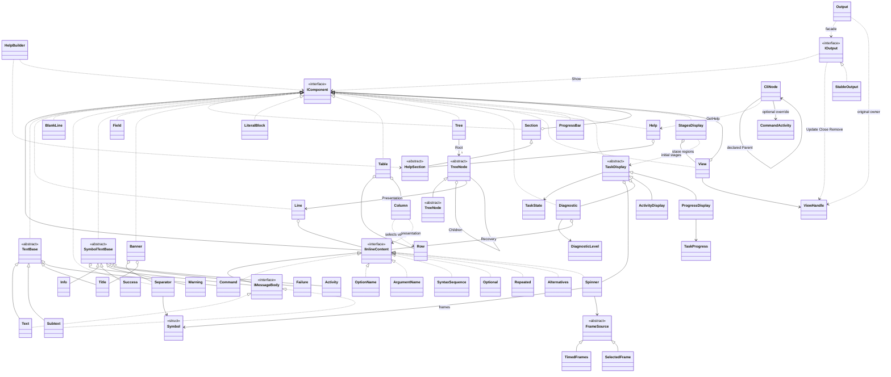

# General Class Diagram

This map summarizes the current public concepts and their ownership. Detailed members and local diagrams belong to their canonical reference documents.

## Responsibilities

Presentation Components describe content; IOutput owns mounted regions. Row/Column support Table, node bases support Tree, and Help composes Sections. Command definitions feed presentation without becoming its renderer.

## Rules

Inheritance indicates API membership. Composition/association lines identify stored or referenced descriptions, not a new inheritance relationship. Symbol is a value, Row/Column are data/view descriptors, and ViewHandle is identity: none becomes inline merely because it contributes to a rendered line.

TreeNodeT below denotes `TreeNode<TData>`; it is abstract and provides typed Value over the same original Data. The diagram omits speculative parser/value/handler classes and adapter transport types.

## Class diagram

## Example

Follow `Table -> Column -> IInlineContent` to distinguish original data selection from cell presentation. Follow `Tree -> TreeNode -> Line` to distinguish hierarchy from its labels. BlankLine only implements IComponent, so no valid path makes it eligible for Line.

See [[docs/structure]] for a complete composition and [[docs/presentation/README]] for the local contracts and diagrams. The backend availability and the purpose of documentary HTML are explained in [[docs/README]].
