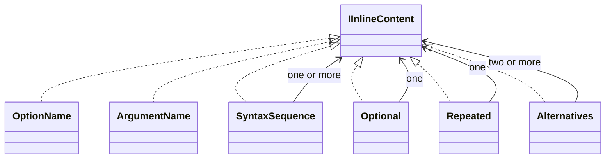

# Arguments and options

One command definition supplies syntax, generated help and eventual binding and validation. Presentation pieces display that definition; they are not parsed back into executable metadata.

## Responsibilities

Keep these independent:

| Dimension | Meaning |
|---|---|
| Value type | What kind of value is accepted |
| Presence requirement | Whether the argument or option must appear |
| Values per occurrence | How many values one occurrence consumes |
| Repeated occurrences | Whether the option can appear more than once |

A collection-valued result is not automatically variadic syntax. An option consuming two values differs from a repeated one-value option and from an option consuming a variable number of values.

## Example

```text
command --size 80 24
command --tag stable --tag local
command --files first.txt second.txt
command --help usage options
```

These examples illustrate distinct cardinalities, not a finalized option-builder API.

## Rules

The help vocabulary contains six inline pieces:

| Piece | Presentation |
|---|---|
| `OptionName` | Option spelling such as `--root` |
| `ArgumentName` | Placeholder such as `<path>` |
| `SyntaxSequence` | Space-separated inline pieces |
| `Optional` | Bracketed child such as `[<path>]` |
| `Repeated` | Repetition marked with an ellipsis |
| `Alternatives` | Alternatives separated by bars |

Source names exclude generated delimiters. `SyntaxSequence` requires at least one item, `Alternatives` at least two, and `Optional`/`Repeated` each wrap one inline child. Option names use `accent.foreground`, placeholder names use `text.foreground`, and generated delimiters use `subtext.foreground`.

`[word]` denotes optional syntax, not an array or a C# argument list. `<word>` denotes an argument placeholder. Rendering these marks does not select a parsing strategy.

### Type and adapter boundary

Types, defaults and choices must have a portable meaning across C#, Python, Nushell and PowerShell. A string-only type identifier does not supply a useful typed authoring contract, and arbitrary `object?` payloads are not a universal transport format.

The exact typed descriptor API belongs to [[docs/questions/cli-value-types|CLI value types]]. Until that contract is defined, examples here deliberately do not invent converters, type registries or handler signatures. Help-option termination and precedence are addressed separately in [[docs/questions/help-option-parsing|Help option parsing]].

See [[docs/presentation/components/help|Help]] for the visual syntax and [[docs/integration/adapter-boundaries|Adapter boundaries]] for language-specific authoring.

## Class diagram


