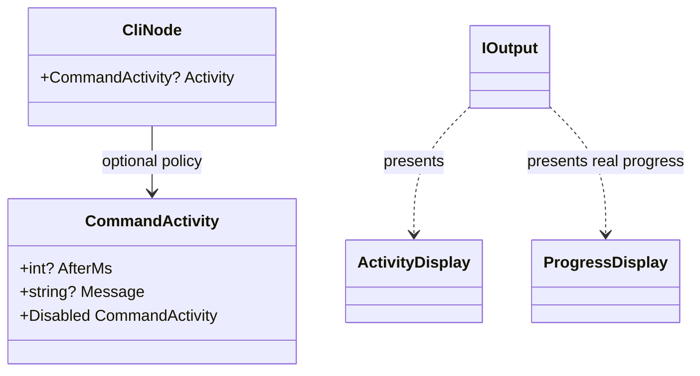

# Automatic activity

The command executor can show delayed indeterminate feedback while a command is still working. This is an execution policy; constructing an activity component alone does not run work or start a clock.

## Responsibilities

The command executor owns the delay, the single automatic feedback region and cleanup. A node optionally supplies a policy; the output presents activity without executing the operation.

## API contract

```toml
[output]
auto-activity-after-ms = 500
```

The omitted setting defaults to 500 ms. A nonnegative integer enables activity with that delay, zero is immediate, and `false` disables it. There is no separate enabled flag or spinner frame-interval setting.

```csharp
public readonly record struct CommandActivity(
    int? AfterMs,
    string? Message = null)
{
    public int? AfterMs { get; }
    public string? Message { get; }
    public static CommandActivity Disabled => new(null);
}

// Member of the command base.
public virtual CommandActivity? Activity => null;
```

| Node value | Policy |
|---|---|
| `null` | Inherit application configuration |
| `CommandActivity.Disabled` | Disable automatic activity |
| `new CommandActivity(800)` | Enable after 800 ms with no message |
| `new CommandActivity(800, "Resolving dependencies")` | Enable with a supplied message |

The default indicator has no message; the system does not invent one from the command title. A disabled policy ignores its message. Negative delays are invalid. There is no parent-command policy inheritance chain.

This is a contract extract: the positional properties are explicitly get-only and initialized from the corresponding validated constructor parameters. Positional notation preserves the named arguments `AfterMs` and `Message` and deconstruction; it does not expose writable `init` properties. A `with` expression cannot replace these fields to bypass delay validation. `default(CommandActivity)` has absent delay and message and is disabled, whereas a null node property inherits configuration. Equality is by the stored policy fields.

## Example

```csharp
public override CommandActivity? Activity =>
    new CommandActivity(800, "Resolving dependencies");
```

The property belongs to a consumer's command type. The extract does not define a new execution handler or base constructor.

## Rules

1. Start work immediately.
2. If work finishes before the delay, show no automatic indicator.
3. Otherwise show indeterminate activity.
4. If real measurable progress is reported, replace the indeterminate display rather than adding another indicator.
5. Clean up on completion, failure or cancellation, then preserve the command's usual result behavior.

Do not fabricate percentages from elapsed time, delay results for a minimum animation duration or print an unsolicited success line. An explicit `Show` is not delayed by this policy. Help, explanation and version routes receive no automatic indicator. Structured output receives no animation or extra records.

The runner owns timing and cleanup. Automatic and explicitly reported progress must coordinate one feedback region. The exact execution-context reporting API is not implied by the policy value.

## Class diagram



See [[docs/configuration/toml|TOML configuration]], [[docs/presentation/components/activity-display|ActivityDisplay]] and [[docs/presentation/components/progress-display|ProgressDisplay]]. `CliNode` here labels the command-base contract rather than introducing a second wrapper around commands.
