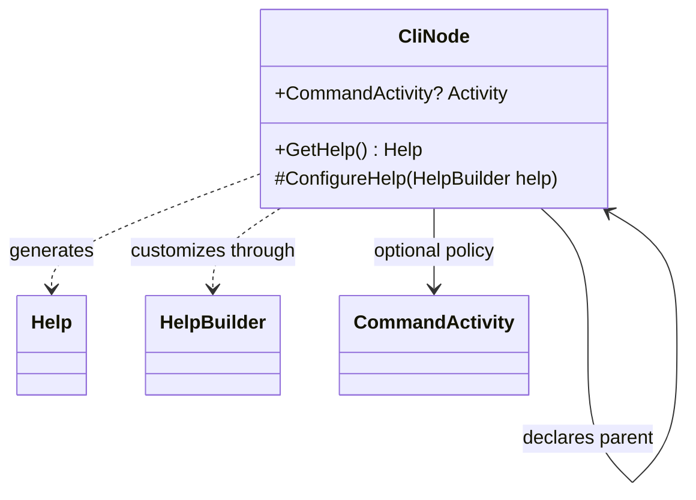

# Command tree

Commands form one semantic tree. A command declares its parent; the root has no parent. The system derives children, so authors do not maintain a second list of subcommands alongside parent declarations.

## Responsibilities

- A command has a name and description.
- It can be grouping-only, executable or executable with children.
- It owns its local options and ordered positional arguments.
- Invocation and help follow its position in the command tree.
- The hierarchy is validated as one rooted, acyclic tree.

Grouping-only describes command behavior; it does not require an abstract CLR class. Commands themselves are the nodes: there is no separate wrapping command-node model and no requirement to inherit the visual `TreeNode`.

## Example

```text
modpack
├── project
│   ├── list
│   └── use
└── config
    └── set
```

For example, `use` declares `project` as its parent and `project` declares `modpack`. This specifies relationships, not a finalized registration or constructor API.

## API contract

The command-base member extracts below are the accepted help and activity seams. They are not a complete command declaration or execution API.

```csharp
public Help GetHelp();

protected virtual void ConfigureHelp(HelpBuilder help);

public virtual CommandActivity? Activity => null;
```

`GetHelp` generates a page without executing the operational command. Customization applies after standard content is generated. The activity property inherits application configuration when omitted.

## Rules

Reject cycles and relationships that cannot form the single command tree. A child relationship is derived, not an independently mutable graph declaration. Exact registration, handler binding and value-conversion signatures are not inferred from these relationships.

Generated help and argument validation consume the same semantic command definitions. Do not maintain a second handwritten catalogue that can drift from executable syntax.

See [[docs/command-system/arguments-and-options|Arguments and options]], [[docs/command-system/help-routing|Help routing]] and [[docs/command-system/automatic-activity|Automatic activity]]. The portable typed-value model is addressed in [[docs/questions/cli-value-types|CLI value types]].

## Class diagram


