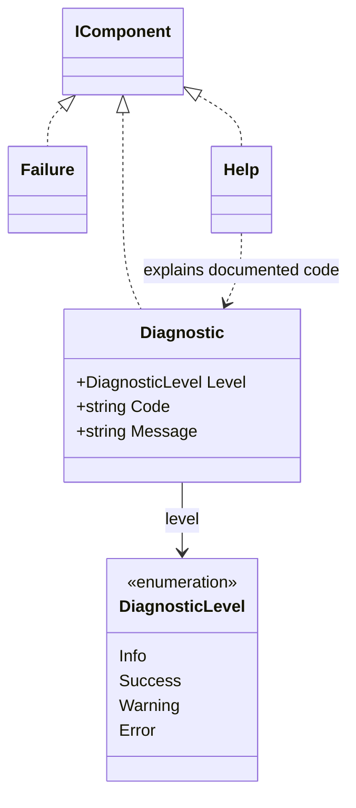

# Diagnostics and execution errors

The Command System separates a failure in execution from the component that presents its explanation. `Failure` is a visual message; `Diagnostic` carries structured diagnostic information. No additional visual `Error` class is required.

## Responsibilities

| Concern | Responsibility |
|---|---|
| Execution failure | Operational command and its execution boundary |
| Diagnostic instance | Level, code, message, optional details and recovery |
| Diagnostic rendering | Presentation components and the selected output |
| General explanation | Help associated with a documented diagnostic code |
| Exit status | Execution policy, not the renderer |

The supported diagnostic levels are Info, Success, Warning and Error. Activity is not a diagnostic severity. Code and summary are nonblank single-line strings; details may contain multiple lines. Recovery is inline content with its original Text, Subtext or Command meaning.

## Rules

Showing a `Diagnostic` does not throw its described failure, run recovery instructions or select an exit status. Including a diagnostic in a task display also does not silently change the task's state.

## Example

```text
modpack --explain Project.RootNotFound
modpack --explain Project.RootNotFound actions examples
```

A programmer-provided stable code can connect an occurrence to general explanatory help. This route covers documented diagnostics rather than only exceptions. Default shipped messages and identifiers are English.

## Structured and human channels

Keep original diagnostic fields available independently of the formatted text. Do not parse a coloured summary to recover its code. The command's documented stdin, stdout, stderr and exit statuses must explain which channel carries domain data and which carries diagnostic presentation.

The exact exception-wrapping, cancellation and handler contracts are execution concerns; this document does not invent a catch-all exception API or promise that every internal failure can be safely exposed verbatim.

See [[docs/presentation/components/diagnostic|Diagnostic]], [[docs/command-system/help-routing|Help routing]] and [[docs/integration/adapter-boundaries|Adapter boundaries]].

## Class diagram


