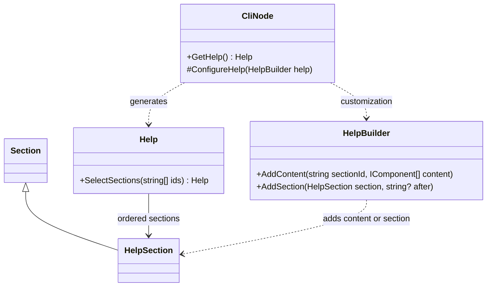

# Help routing

Help is available without executing the selected command or requiring a valid operational project. All built-in identifiers, titles and fallback text are English; application-supplied content is preserved.

## Example

```text
modpack project use --help
modpack project use --help usage options
modpack project use -h examples io
```

`--help` and `-h` accept zero or more section identifiers. No identifiers selects the whole page. Selection is immutable, preserves page order and deduplicates requests; unknown or unavailable identifiers fail with the available identifiers. Selecting sections hides the introductory description in presentation without deleting source metadata.

| Standard section | Identifier |
|---|---|
| Usage | `usage` |
| Subcommands | `subcommands` |
| Parameters | `parameters` |
| Options | `options` |
| Examples | `examples` |
| Input/output | `io` |
| Notes | `notes` |

Options precede examples. Help contains no Banner. Input/output documents stdin, stdout, stderr and exit status.

## Responsibilities

The following are API extracts, not complete class definitions:

```csharp
// Command-base members.
public Help GetHelp();
protected virtual void ConfigureHelp(HelpBuilder help);

// Help members.
public Help SelectSections(params IEnumerable<string> ids);

// HelpBuilder members.
public void AddContent(string sectionId, params IEnumerable<ComponentInput> content);
    public void AddContent(string sectionId, IEnumerable<IComponent> content);
public void AddSection(HelpSection section, string? after = null);
```

The engine generates defaults, invokes customization, validates and freezes the page. Selecting a page does not rerun customization. `AddContent` appends, can activate an omitted standard section and rejects unknown identifiers. `AddSection` inserts a whole custom section; duplicate identifiers and absent anchors fail. Multiple insertions after the same anchor retain call order. There are no automatic-content Remove/Replace operations.

### Diagnostic explanations

```text
modpack --explain Project.RootNotFound
modpack --explain Project.RootNotFound actions examples
```

The first value is the diagnostic code, followed by zero or more section identifiers. This documents diagnostic meanings at any level, not only failures. The full explanation is selected when no section identifiers follow. The same page-selection rules apply.

A diagnostic explanation describes a documented code; a concrete `Diagnostic` describes one occurrence. Do not require a current failure instance to consult its explanation.

## Rules

Metadata routes do not start automatic command activity. Their syntax does not settle precedence against positional values, subcommands or `--`; see [[docs/questions/help-option-parsing|Help option parsing]]. Parser behavior must not be guessed from formatted usage text.

See [[docs/presentation/components/help|Help]] for the component contracts and [[docs/command-system/diagnostics|Diagnostics]] for the execution boundary.

## Class diagram


