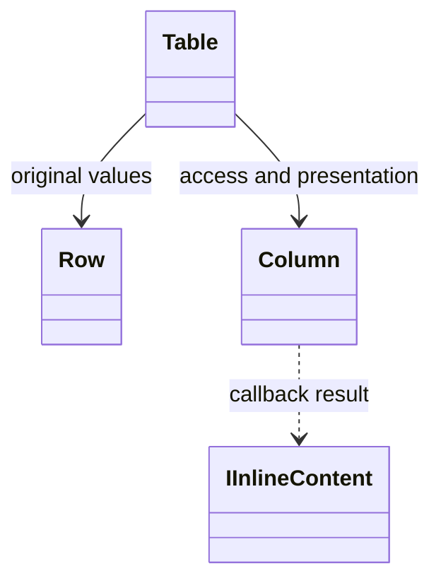

# Adapter boundaries

C# is the shared backend language and the notation for official contracts. Python, Nushell and PowerShell adapters provide idiomatic construction, composition and ordinary customization without requiring CLR wrappers or runtime CLR subclass generation for normal use.

## Responsibilities

| Layer | Responsibility |
|---|---|
| Consumer | Domain values, hierarchy, labels, presentation choices and operational work |
| Adapter | Native language values, callbacks and supported contract descriptions |
| Backend | Validated component model, rendering, measurement and output lifetime |
| Command executor | Handler lifecycle, cancellation, diagnostics and automatic-feedback coordination |

Constructors describe content; they do not print. Data, presentation, output identity and command execution remain separate. The exact .NET baseline is addressed in [[docs/integration/build-baseline|Build baseline]] and deployment in [[docs/questions/native-aot-or-jit|Native AOT or JIT]].

## Rules

Input unions normalize strings to Text only, never to Subtext. Native value-to-text conversion preserves original logical type information and captures display text once. Tables require at least one data row, take columns before rows, and classify Auto alignment from original values rather than formatted strings. Source selectors preserve complete source objects separately from selected cells. Native records and arrays must be usable as table rows without manually creating CLR `Row` instances. Trees may retain arrays, dictionaries, scalars or consumer objects and derive children explicitly. A stored value does not automatically become a child relationship.

## Example

The C# usage below describes a typed presentation callback:

```csharp
var table = new Table(
    [new Column("Name", index: 0),
     Column.For<long>("Size", index: 1,
         presentation: bytes => new Subtext($"{bytes / 1024} KiB"))],
    new Row("README.md", 2048L));
```

The original numeric value remains 2048. A native adapter offers its own function form; the design does not require sending a CLR delegate across processes. Callbacks execute where their state lives and communicate supported descriptions or values.

## Customization boundary

Ordinary composition, application node types, help sections, formatting callbacks and custom-token references belong within the adapter authoring experience. Reusable derivation of supported contracts is the selected exploration direction, not a promise of arbitrary CLR inheritance. See [[docs/questions/adapter-derivation|Adapter derivation]]. There is no public `CustomHelpSection` convenience class.

New rendering or measurement behavior belongs to a C# backend extension. A string token name changes a part's colour; it does not define a renderer. No public renderer-registration signature is inferred from this boundary.

## Structured data

Human output and native values are separate results of presentation. Never recover domain values by reverse-parsing a table, tree label or coloured diagnostic.

- Preserve original field names, supported logical types and values rather than formatted cell strings.
- Column labels and selected displayed columns do not silently rewrite the original records.
- Keep tree hierarchy separate from its branch characters and node labels.
- After native sorting, projection or filtering, metadata must remain valid; discard stale metadata rather than resurrecting cached values.
- An arbitrary CLR object retained by `TreeNode.Data` is not automatically portable.
- Structured output receives no ANSI, animation frames or decorative blank lines.

The exact supported-value profile and transport are addressed in [[docs/questions/adapter-transport|Adapter transport]]. The adapter establishes the borrowed TextWriter context defined in [[docs/presentation/output/sessions-and-handles|Sessions and handles]]. Spectre types remain internal to the backend; native structured values bypass human rendering.

## Language policy

Built-in identifiers, comments, help labels, diagnostics and fallback text are English. Application-supplied content is preserved. Stable section and diagnostic identifiers are separate from visible labels.

These are integration contracts, not a claim that native-shell bindings or end-to-end transport tests already exist. The concrete C# contracts remain in [[docs/presentation/README|Presentation]] and [[docs/command-system/README|Command System]].

## Class diagram


