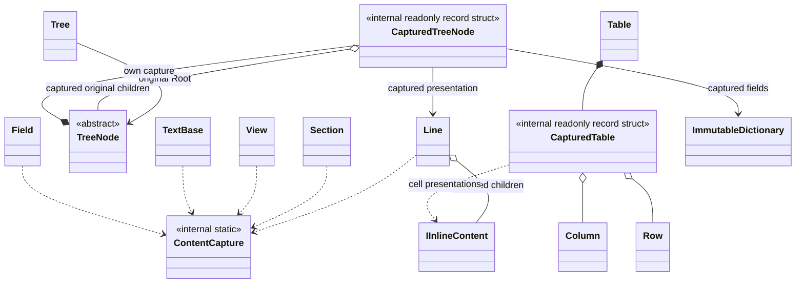

# Model and construction

Construction stabilizes a presentation description without writing output. Capture means evaluating an input at its defined boundary and retaining the result: a copied sequence, converted text, selected cell presentation or node fields. It does not require a separate capture class for every component.

## Responsibilities

| Layer | Retained information |
|---|---|
| Original data | Original values, source objects and supported logical types |
| Component description | Captured text, children, selectors' results and declared task state |
| Output session | Destination, effective colours, dimensions, placement and current frames |

This is the accepted construction design. Contracts below are extracts without implementation bodies, not compiling sources or implemented library features. Public owners remain [[docs/presentation/composition|Composition]], [[docs/presentation/components/table|Table]], [[docs/presentation/components/tree|Tree]] and [[docs/presentation/output/README|Output]].

## API contract

```csharp
using System.Collections.Immutable;

internal static class ContentCapture
{
    internal static string Text(object? value);

    internal static ImmutableArray<IInlineContent> Inline(
        IEnumerable<InlineInput> content);
    internal static ImmutableArray<IInlineContent> Inline(
        IEnumerable<IInlineContent> content);

    internal static ImmutableArray<IComponent> Blocks(
        IEnumerable<ComponentInput> content);
    internal static ImmutableArray<IComponent> Blocks(
        IEnumerable<IComponent> content);
}

internal readonly record struct CapturedTable(
    ImmutableArray<Column> Columns,
    ImmutableArray<Row> Rows,
    ImmutableArray<ImmutableArray<IInlineContent>> CellPresentations);

internal readonly record struct CapturedTreeNode(
    ImmutableDictionary<string, object?> Data,
    Line Presentation,
    ImmutableArray<TreeNode> Children);
```

ContentCapture is a small shared toolbox, not an injectable service, renderer, or mandatory build pipeline. Text captures the shared value conversion; the owning component applies its own Unicode/control/line rules. Inline and Blocks enumerate finite input once, normalize strings to Text and reject null/default inputs. Existing components are retained, not deep-cloned. BlankLine is block-only and cannot enter Inline.

The owner validates capture aggregates before storing them; default(CapturedTable) and default(CapturedTreeNode) are unusable internal states. Their positional properties are internal-construction tools, not public invariant-preserving component constructors. Generated equality compares member values according to their types; it is not deep visual equality and must not drive redraw decisions. No deep equality of arrays, dictionaries, sources or delegates is implied.

## Class diagram



Each captured child reference leads to the original child node with its own capture. There is no second tree of captured-node objects, nor an Original backlink in each capture.

## Rules

### Ownership and collections

Accept IEnumerable inputs where the public contract permits and capture each finite sequence once. Do not retain deferred queries for rendering. Use ImmutableArray internally where suitable and IReadOnlyList for public indexed access without exposing storage choice. ImmutableArray implements IReadOnlyList; the interface alone does not make an incoming mutable collection stable. Converting a value-type collection to an interface may box; this storage choice is not a zero-allocation promise. Implementation should avoid repeated boxing on hot paths.

Copy containers without deep-cloning their elements. OriginalValue, Row.Source and TreeNode<TData>.Value preserve original references/types where specified. Stable collections do not freeze mutable objects inside them. An ordinary description can be reused; explicit View identities retain their separate single-placement rule.

### Construction boundaries

| Owner | Construction work |
|---|---|
| Text, Subtext, Field | Convert once, retain original value/type and validate the resulting text |
| Line, Section, View | Normalize inputs and snapshot ordered child collections |
| Row | Capture raw values/names, without assigning cell presentation |
| Column | Retain selection, presentation callback and alignment preference |
| Table | Capture rows/columns, select values and evaluate presentation once per cell |
| Tree | Ensure per-node captures exist and validate complete structure |
| Spinner and task displays | Retain declared frames/source/state; start no clocks |
| View | Reserve identity; bind no session until mounted |

Line/Section/View keep their own captured collections; no CapturedLine or duplicate component hierarchy is required. TextBase and Field keep their accepted original/value members without a CapturedText wrapper.

### Table aggregate

Table keeps one CapturedTable. Its public Rows and Columns expose the aggregate's collections rather than duplicate them. CellPresentations is indexed by data-row position then displayed-column position; its outer length equals Rows.Length and every inner length equals Columns.Length. Rows remain nonempty; zero displayed columns produces empty presentation rows without dropping original data.

Rows retain original values and optional source objects, including non-displayed data. Columns select those stored values; CellPresentations retains already normalized inline results. Do not add CapturedCell just to duplicate each selected original value. Reading a captured Row by index/field is a lookup, not another invocation of consumer code. Table.From executes source selectors at construction and stores selected values in normalized Rows while retaining each original Row.Source.

Capture input collections, validate structural selections, evaluate required selectors/presentation callbacks, then retain the complete validated aggregate. Never re-run callbacks or default ToString conversion during measurement, resize, repaint or another Show of that table. Errors prevent a valid constructed result and emit nothing; side effects in consumer callbacks cannot be rolled back. Consumers should provide side-effect-free selectors/presenters.

### Node-owned capture

TreeNode.Data is a non-null IReadOnlyDictionary<string, object?> of declared fields, separate from the typed Value offered by TreeNode<TData>. An empty mapping is valid. Capture with ordinal, case-sensitive keys; missing differs from null. Copy the mapping while preserving field spelling and original values. Mapping enumeration does not define table column order. Arrays/dictionaries stored as values do not implicitly create child relations. Native portability is governed by [[docs/integration/adapter-boundaries|Adapter boundaries]].

A node acquires one successful capture on its first use in Tree construction. Read its Data, Children, Presentation and MaxChildren at the capture boundary. Retain fields, line and original child references in the node's capture; validate MaxChildren without storing redundant renderer metadata. Do not call virtual properties from a base constructor, publish partial capture state or treat an incomplete attempt as captured. Synchronization and failure propagation are implementation responsibilities; no public refresh method is introduced.

Reusing a node reuses its capture across trees. Tree.Root remains the original node, including subtype identity; rendering and structured export read captured fields/relations, not changing original getters. Build new nodes to refresh content. Each Tree still checks cycles and repeated node positions even with existing captures. Existing capture reuse does not permit the same node to occupy two positions in a single tree. Underlying source objects remain references and are not deeply frozen.

Tree.From creates internal nodes from an existing nested source. Its required data, children and presentation selectors receive the current source object and run during first capture, never repaint. No reflection invents fields. Direct consumer subclasses instead define those same responsibilities through properties; both paths fulfill the same TreeNode contract.

### Validation and later phases

Local constructors validate their values and component membership. Composition validates row/field selection, graph invariants and callback results. Token-name resolution against effective configuration belongs to preparation for output; scope/handle ownership belongs to placement. No terminal access is required to construct a valid description.

Do not store resolved RGB, terminal width, wrapped lines, calculated Section depth, cursor positions or current temporal frames in these captures. Those belong to subsequent context, layout and session phases. Component state does not become a Spectre object at construction.

## Example

```csharp
var row = new Row("archive.zip", 2048L);
var table = new Table(
    [new Column("Name", index: 0),
     Column.For<long>("Size", index: 1,
         presentation: bytes => $"{bytes / 1024} KiB")],
    row);

using (Output.Use(Console.Error))
{
    table.Show();
}
using var writer = new StreamWriter("report.txt");
using (Output.Use(writer))
{
    table.Show();
}
```

The size presenter ran when the table was constructed, not once per destination. Both presentations retain the numeric 2048L. Changing destination redoes context-dependent layout and styling, not source selection or consumer formatting. See [[docs/presentation/components/tree|Tree]] for the corresponding data/children/presentation selectors and original-node reuse rules.
