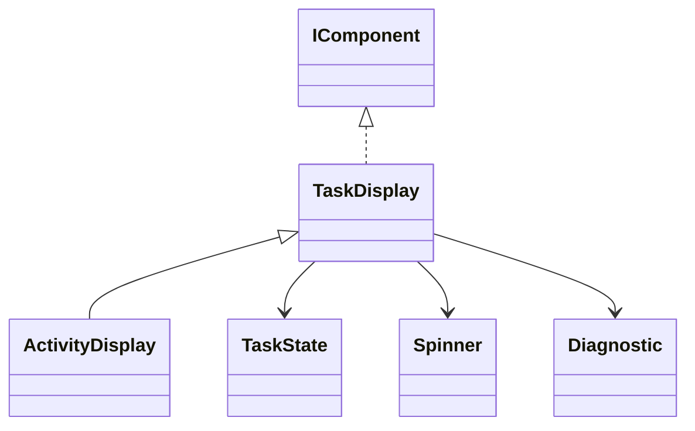

# ActivityDisplay

The ready-made indeterminate task display: state indicator, title and optional secondary detail.

## Usage

```csharp
var handle = new ActivityDisplay(
    "Resolving dependencies",
    detail: "Checking package metadata").Show();
// When actual work has finished:
handle.Update(new ActivityDisplay(
    "Resolving dependencies", state: TaskState.Succeeded));
handle.Close();
```

Constructing the description does not print. `Show` is the explicit output boundary; see [[docs/presentation/output|Output]].

## API contract

These are API extracts, not implementation bodies or a compiling source file.

```csharp
public sealed class ActivityDisplay : TaskDisplay
{
    public ActivityDisplay(string title, string? detail = null,
        TaskState state = TaskState.Running, Spinner? spinner = null,
        Diagnostic? diagnostic = null);
}
```

## Composition

Specializes TaskDisplay from [[docs/presentation/progress-model|Progress model]]. Reuses Spinner and Text/Subtext; an optional Diagnostic remains a structured explanation. Use this when no reliable total exists.



## Behavior and validation

Title is required single-line text. Detail is optional secondary text. Only Running animates; omission of Spinner selects its default. State is explicit; a Diagnostic does not change it or trigger work.

## Presentation

The preview shows the semantic arrangement. Browser rendering is illustrative; it does not verify terminal cell measurement.

### Colour tokens

| Part | Token |
|---|---|
| Running indicator | `accent.foreground` |
| Success indicator | `success.symbol.foreground` |
| Failure indicator | `failure.symbol.foreground` |
| Title/body | `text.foreground` |
| Detail and pending structure | `subtext.foreground` |

### Layout

Keep the indicator and body aligned; wrap details without truncation. The whole task display requests one collapsed lower gap, not a gap after every internal line.

Shared wrapping, Unicode and control handling are defined in [[docs/presentation/text-and-layout|Text and layout]]. Automatic margins collapse by maximum; explicit [[docs/presentation/components/blank-line|BlankLine]] remains additional content.

## Preview

![[docs/assets/captures/activity-display.png]]

[Open interactive preview](../../assets/previews/activity-display.html)

### Preview source

```csharp
var handle = new ActivityDisplay(
    "Resolving dependencies",
    detail: "Checking package metadata").Show();
// When actual work has finished:
handle.Update(new ActivityDisplay(
    "Resolving dependencies", state: TaskState.Succeeded));
handle.Close();
```

## Live behavior

The capture shows the initial Show snapshot; the Update control corresponds to the explicit successful replacement in the source. Update by replacing the description, preserving the output handle. Stop animation on terminal states or Close/Remove. The component never schedules dependency resolution or chooses success itself.

## Structured data

Keep Title, Detail, State and Diagnostic separate. Activity reports an unknown total and must not derive a percentage from elapsed time.
