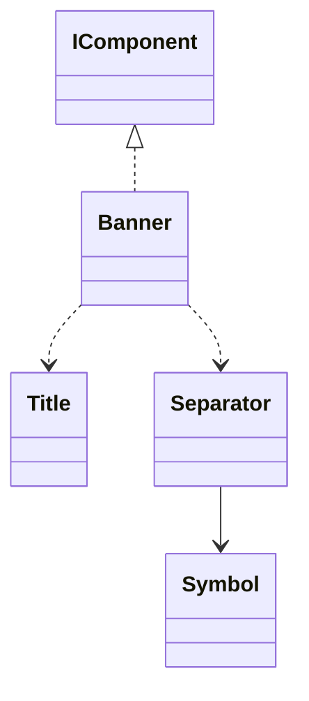

# Banner

A title between two repeated separators, intended for explicit introductions rather than help pages.

## Usage

```csharp
new Banner("ModpackTools 5.0.0", new Symbol("═")).Show();
```

Constructing the description does not print. `Show` is the explicit output boundary; see [[docs/presentation/output|Output]].

## API contract

These are API extracts, not implementation bodies or a compiling source file.

```csharp
public sealed class Banner : IComponent
{
    public Banner(string title);
    public Banner(string title, Symbol symbol);
}
```

## Composition

Composes a Title and two Separators using the same Symbol. The pattern is a value, not a child component.



## Behavior and validation

Title is single-line text. Default pattern is =; the explicit valid Symbol applies to both rules. Banner owns = as its safe fallback. No width or colour options on the instance. Do not insert banners into Help.

## Presentation

The preview shows the semantic arrangement. Browser rendering is illustrative; it does not verify terminal cell measurement.

### Colour tokens

| Part | Token |
|---|---|
| Title | `title.foreground` |
| Rules | `subtext.foreground` |

### Layout

No inner blank line between the title and rules. Request one collapsed lower gap after the bottom rule.

Shared wrapping, Unicode and control handling are defined in [[docs/presentation/text-and-layout|Text and layout]]. Automatic margins collapse by maximum; explicit [[docs/presentation/components/blank-line|BlankLine]] remains additional content.

## Preview

![[docs/assets/captures/banner.png]]

[Open interactive preview](../../assets/previews/banner.html)

### Preview source

```csharp
new Banner("ModpackTools 5.0.0", new Symbol("═")).Show();
```
