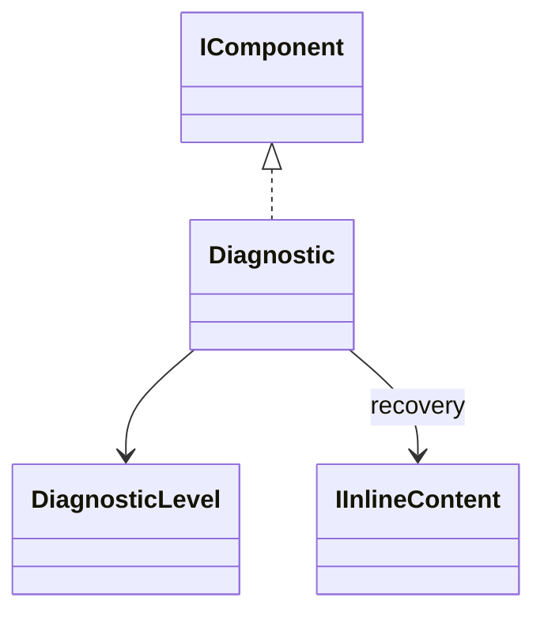

# Diagnostic

A structured explanation composed as a block. A diagnostic is not an exception, an exit status or an instruction to run its recovery.

## Usage

```csharp
new Diagnostic(DiagnosticLevel.Error,
    "Project.RootNotFound",
    "The configured project folder does not exist.",
    details: "Directory: D:/Projects/demo",
    recovery: new Command("modpack config set root D:/Projects"))
    .Show();
```

Constructing the description does not print. `Show` is the explicit output boundary; see [[docs/presentation/output/README|Output]].

## API contract

These are API extracts, not implementation bodies or a compiling source file.

```csharp
public enum DiagnosticLevel { Info, Success, Warning, Error }

public sealed class Diagnostic : IComponent
{
    public Diagnostic(DiagnosticLevel level, string code, string message,
        string? details = null, InlineInput? recovery = null);
    public DiagnosticLevel Level { get; }
    public string Code { get; }
    public string Message { get; }
    public string? Details { get; }
    public IInlineContent? Recovery { get; }
}
```

## Composition

Level selects Info, Success, Warning or Failure summary composition. Render bracketed code on a separate secondary line, optional Details text and an optional Try line with the recovery inline piece. It adds no Section or heading.



## Behavior and validation

Reject undefined enum values. Code is stable, nonblank and single-line, without whitespace, controls or literal brackets. Message is nonblank single-line text without outer whitespace. Optional details use null for absence; non-null blank content is invalid and multiline content follows shared text rules. An absent Recovery is null; a supplied InlineInput must not be default/null and strings normalize to Text before storage as IInlineContent. Recovery is a nonblank single-line inline description, preserving its meaning. Never automatically execute it or expose a stack trace.

## Presentation

The preview shows the semantic arrangement. Browser rendering is illustrative; it does not verify terminal cell measurement.

### Colour tokens

| Part | Token |
|---|---|
| Info indicator | `accent.foreground` |
| Success indicator | `success.symbol.foreground` |
| Warning indicator | `warning.symbol.foreground` |
| Error indicator | `failure.symbol.foreground` |
| Message | `text.foreground` |
| Code, Details and Try labels | `subtext.foreground` |
| Recovery | `Its inline token` |

### Layout

Indent metadata/details/recovery by two cells when possible; reduce indentation and wrap without silent truncation. Request one collapsed lower gap after the complete diagnostic.

Shared wrapping, Unicode and control handling are defined in [[docs/presentation/text-and-layout|Text and layout]]. Automatic margins collapse by maximum; explicit [[docs/presentation/components/blank-line|BlankLine]] remains additional content.

## Preview

![[docs/assets/captures/diagnostic.png]]

[Open interactive preview](../../assets/previews/diagnostic.html)

### Preview source

```csharp
new Diagnostic(DiagnosticLevel.Error,
    "Project.RootNotFound",
    "The configured project folder does not exist.",
    details: "Directory: D:/Projects/demo",
    recovery: new Command("modpack config set root D:/Projects"))
    .Show();
```

## Structured data

Level, Code, Message, Details and Recovery remain separate fields. Code can identify a DiagnosticHelp page through --explain. The component does not choose stdout/stderr or an exit code. Domain result payloads and execution-boundary exception conversion belong to the command/integration system; never reconstruct them from printed text.
