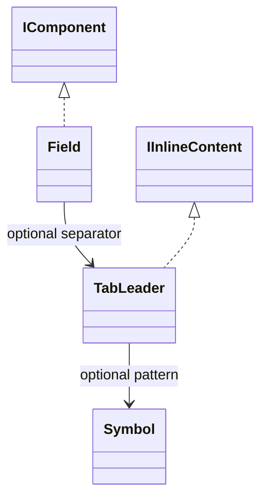

# Field

A compact textual label/value pair. Scalar wrappers are unnecessary for this presentation.

## Usage

```csharp
var dotted = new TabLeader(14, new Symbol("."));
Output.Show(
    new Field("Project", "demo"),
    new Field("Files", 12),
    new Field("Project", "demo", dotted),
    new Field("Files", 12, dotted));
```

Constructing the description does not print. `Show` is the explicit output boundary; see [[docs/presentation/output|Output]].

## API contract

These are API extracts, not implementation bodies or a compiling source file.

```csharp
public sealed class Field : IComponent
{
    public Field(string label, object? value, TabLeader? separator = null);
    public string Label { get; }
    public object? OriginalValue { get; }
    public Type? OriginalType { get; }
    public string Value { get; }
    public TabLeader? Separator { get; }
}
```

## Composition

Composes a secondary label and separator followed by normal text. Omission of separator produces the ordinary colon and space. An explicit TabLeader replaces that complete colon-and-space sequence. The value uses the shared TextBase conversion policy and retains its original value and type; this does not turn a label/value presentation into a domain record.



## Behavior and validation

Label remains a non-null structural string. Capture the value using the shared conversion policy in [[docs/presentation/composition|Composition]], then require its text to be one logical line with well-formed Unicode and no controls. Do not parse values or infer commands. No Scalar wrapper is required. A supplied TabLeader must satisfy its width and optional-Symbol invariants; default(TabLeader) is valid and adds a space, whereas an explicitly supplied default(Symbol) is invalid. There is no independent Field labelWidth option.

## Presentation

The preview shows the semantic arrangement. Browser rendering is illustrative; it does not verify terminal cell measurement.

### Colour tokens

| Part | Token |
|---|---|
| Label and separator | `subtext.foreground` |
| Value | `text.foreground` |

### Layout

An omitted separator renders Label: Value. With TabLeader, measure the complete logical prefix before the value and exclude enclosing structural indentation. The target is not a fixed number of dots. No lower gap between fields. A single logical line may wrap physically; reduce indentation before hiding content.

Shared wrapping, Unicode and control handling are defined in [[docs/presentation/text-and-layout|Text and layout]]. Automatic margins collapse by maximum; explicit [[docs/presentation/components/blank-line|BlankLine]] remains additional content.

## Preview

![[docs/assets/captures/field.png]]

[Open interactive preview](../../assets/previews/field.html)

### Preview source

```csharp
var dotted = new TabLeader(14, new Symbol("."));
Output.Show(
    new Field("Project", "demo"),
    new Field("Files", 12),
    new Field("Project", "demo", dotted),
    new Field("Files", 12, dotted));
```
