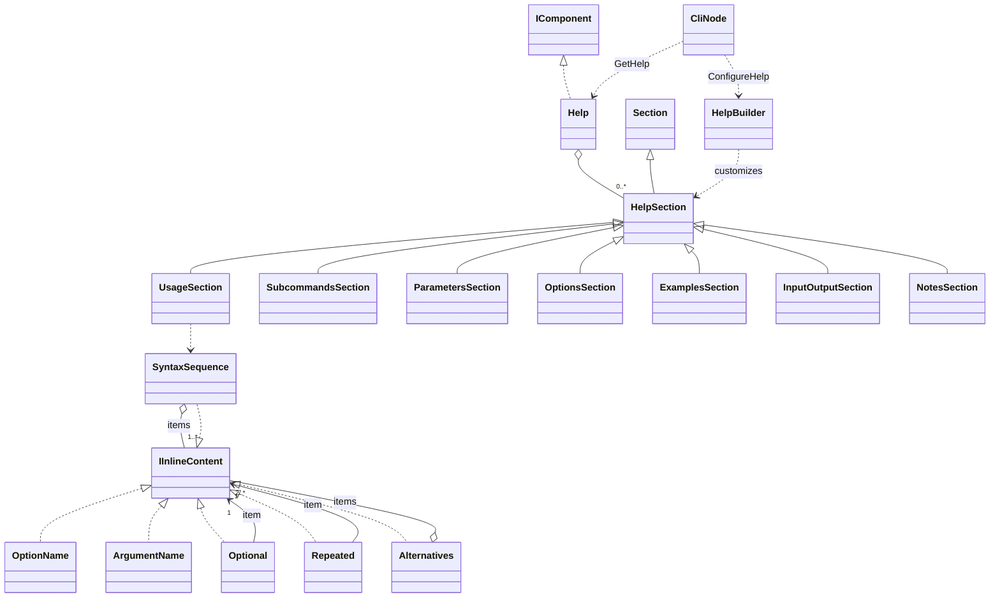

# Help

An immutable help page built from command or diagnostic definitions. It reuses Section and the ordinary visual vocabulary; there is no Banner.

## Usage

```csharp
// projectUse is a command definition from the application.
var page = projectUse.GetHelp();
page.SelectSections("usage", "options", "examples").Show();
```

Constructing the description does not print. `Show` is the explicit output boundary; see [[docs/presentation/output/README|Output]].

## API contract

These are API extracts, not implementation bodies or a compiling source file.

```csharp
public sealed class Help : IComponent
{
    public string Description { get; }
    public IReadOnlyList<HelpSection> Sections { get; }
    public Help SelectSections(params IEnumerable<string> ids);
}

public abstract class HelpSection : Section
{
    protected HelpSection(string id, string title,
        params IEnumerable<ComponentInput> children);
    protected HelpSection(string id, string title,
        IEnumerable<IComponent> children);
    public string Id { get; }
}

public sealed class HelpBuilder
{
    public void AddContent(string sectionId, params IEnumerable<ComponentInput> content);
    public void AddContent(string sectionId, IEnumerable<IComponent> content);
    public void AddSection(HelpSection section, string? after = null);
}

// Members of the command base, not constructors of Help:
public Help GetHelp();
protected virtual void ConfigureHelp(HelpBuilder help);

// Inline syntax constructor extracts:
public OptionName(string name);
public ArgumentName(string name);
public SyntaxSequence(params IEnumerable<InlineInput> items);
public SyntaxSequence(IEnumerable<IInlineContent> items);
public Optional(InlineInput item);
public Repeated(InlineInput item);
public Alternatives(params IEnumerable<InlineInput> items);
public Alternatives(IEnumerable<IInlineContent> items);
```

## Composition

HelpSection inherits Section geometry and adds a stable Id distinct from Title. Standard classes/IDs are UsageSection/usage, SubcommandsSection/subcommands, ParametersSection/parameters, OptionsSection/options, ExamplesSection/examples, InputOutputSection/io and NotesSection/notes. CommandHelp and DiagnosticHelp are generation templates, not two incompatible renderers. Inline/component input unions normalize strings to Text at authoring boundaries; typed collection overloads accept existing component sequences. Syntax arity and validation apply after normalization. Six inline syntax pieces compose usage: OptionName, ArgumentName, SyntaxSequence, Optional, Repeated and Alternatives.



## Behavior and validation

Generation builds automatic sections, invokes ConfigureHelp, validates and freezes. GetHelp never executes the command. SelectSections with no IDs returns the full view; requested IDs preserve page order, deduplicate, omit introductory prose and reject unknown/absent sections without mutating the page. AddContent appends, can activate an omitted standard section, rejects unknown IDs and ignores empty content. AddSection inserts after an existing anchor or appends; duplicates/absent anchors fail and repeated insertions retain call order. No CustomHelpSection or automatic-content removal API.

## Presentation

The preview shows the semantic arrangement. Browser rendering is illustrative; it does not verify terminal cell measurement.

### Colour tokens

| Part | Token |
|---|---|
| Titles | `title.foreground` |
| Option names and commands | `accent.foreground` |
| Placeholder text and prose | `text.foreground` |
| Syntax punctuation, secondary labels and rules | `subtext.foreground` |

### Layout

Use Section for every help subsection, options before examples. Usage delimiters are generated, never included in source names: <argument>, [optional], repeated... and alternatives with |. SyntaxSequence needs at least one item, Alternatives at least two; Optional/Repeated wrap one inline item. Help uses Section margins and shared wrapping.

Shared wrapping, Unicode and control handling are defined in [[docs/presentation/text-and-layout|Text and layout]]. Automatic margins collapse by maximum; explicit [[docs/presentation/components/blank-line|BlankLine]] remains additional content.

## Preview

![[docs/assets/captures/help.png]]

[Open interactive preview](../../assets/previews/help.html)

### Preview source

```csharp
// projectUse is a command definition from the application.
var page = projectUse.GetHelp();
page.SelectSections("usage", "options", "examples").Show();
```

## Structured data

Generate syntax from definitions; never parse definitions back out of styled usage. InputOutput documents stdin, stdout, stderr and exit status. DiagnosticHelp documents codes generally, separately from concrete Diagnostic instances. [[docs/command-system/help-routing|Help routing]] owns --help/-h and --explain parsing.

## Customization

Application commands add explanatory content through ConfigureHelp. Extend HelpSection for a new reusable section kind; defaults remain generated and do not require a base call merely to retain framework content. Ordinary inherited author hooks still follow normal base-call rules. [[docs/integration/adapter-boundaries|Adapters]] provide native customization without requiring arbitrary CLR subclass generation. The preview uses application-owned projectUse metadata rather than inventing a public Help(command) constructor.
