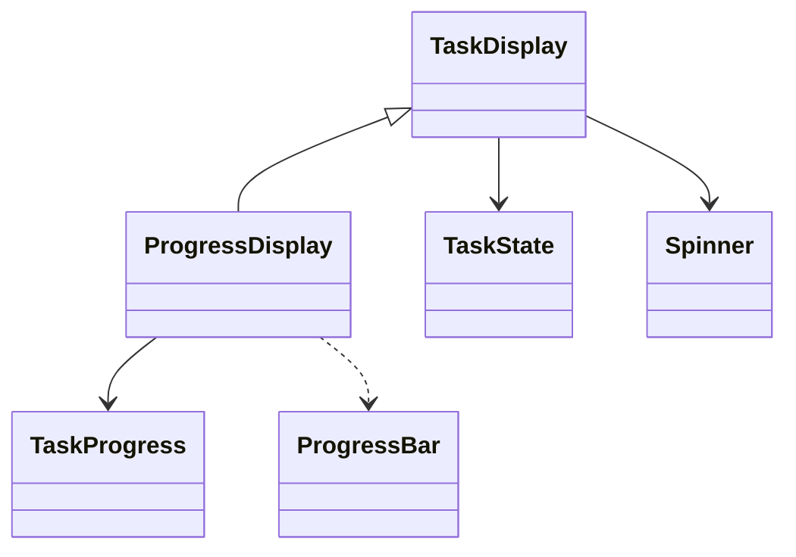

# ProgressDisplay

The ready-made measured task display: explicit state, title, real counts, percentage, bar and optional detail.

## Usage

```csharp
var handle = new ProgressDisplay(
    "Downloading files", new TaskProgress(12, 40, "files")).Show();
handle.Update(new ProgressDisplay(
    "Downloading files", new TaskProgress(25, 40, "files")));
handle.Close();
```

Constructing the description does not print. `Show` is the explicit output boundary; see [[docs/presentation/output/README|Output]].

## API contract

These are API extracts, not implementation bodies or a compiling source file.

```csharp
public sealed class ProgressDisplay : TaskDisplay
{
    public ProgressDisplay(string title, TaskProgress progress,
        string? detail = null, TaskState state = TaskState.Running,
        Spinner? spinner = null, Diagnostic? diagnostic = null);
    public TaskProgress Progress { get; }
}
```

## Composition

Specializes TaskDisplay and uses TaskProgress, Spinner and ProgressBar. Counts and state are separate. Use ActivityDisplay until an actual total is available, then replace it through the same output handle.



## Behavior and validation

Total must be known; null total is invalid for this display. Apply all TaskProgress rules. A completed count equal to total does not imply Succeeded; final validation may remain. Detail/Diagnostic are optional and do not affect counts.

## Presentation

The preview shows the semantic arrangement. Browser rendering is illustrative; it does not verify terminal cell measurement.

### Colour tokens

| Part | Token |
|---|---|
| Indicator | `State-dependent standard token` |
| Title, counts and completed bar | `text.foreground` |
| Detail and pending bar | `subtext.foreground` |

### Layout

Present counts/unit/percentage with the title and bar, adjusting to available width. One collapsed lower gap belongs to the complete display. No simulated percentage, added progress colours or timing-based fill.

Shared wrapping, Unicode and control handling are defined in [[docs/presentation/text-and-layout|Text and layout]]. Automatic margins collapse by maximum; explicit [[docs/presentation/components/blank-line|BlankLine]] remains additional content.

## Preview

![[docs/assets/captures/progress-display.png]]

[Open interactive preview](../../assets/previews/progress-display.html)

### Preview source

```csharp
var handle = new ProgressDisplay(
    "Downloading files", new TaskProgress(12, 40, "files")).Show();
handle.Update(new ProgressDisplay(
    "Downloading files", new TaskProgress(25, 40, "files")));
handle.Close();
```

## Structured data

TaskProgress retains numeric Completed and Total and an optional Unit. Human percent and formatted units do not replace them.

## Live behavior

The capture shows the initial Show snapshot. The Update control corresponds to the explicit replacement in the example, not an automatic work loop. Close freezes the last state and stops its spinner; it does not mark the download successful. Stable output appends meaningful snapshots rather than repainting frames.
