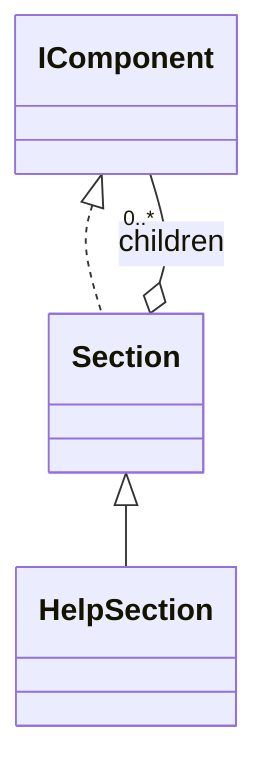

# Section

A titled block that organizes children, computes its visual depth from nesting and optionally shows a domain count.

## Usage

```csharp
Output.Show(
    new Section("Project", 3,
        new Field("Name", "demo"),
        new Section("Content",
            new Field("Files", 12),
            new Section("Validation", new Success("Checks passed.")))),
    "Report complete.");
```

Constructing the description does not print. `Show` is the explicit output boundary; see [[docs/presentation/output/README|Output]].

## API contract

These are API extracts, not implementation bodies or a compiling source file.

```csharp
public class Section : IComponent
{
    public Section(string title, params IEnumerable<ComponentInput> children);
    public Section(string title, int count, params IEnumerable<ComponentInput> children);
    public Section(string title, IEnumerable<IComponent> children);
    public Section(string title, int count, IEnumerable<IComponent> children);
    public string Title { get; }
    public int? Count { get; }
    public IReadOnlyList<IComponent> Children { get; }
}
```

## Composition

Strings normalize to Text through ComponentInput. Collection overloads accept existing component sequences directly. Children are arbitrary supported IComponent blocks, including sections. HelpSection specializes Section and retains its geometry. Descriptions store no mutable parent or level.



## Behavior and validation

Snapshot children and reject null entries. Title is single-line text; count is nonnegative explicit domain data, not automatic outline numbering. Preserve child order. Compute levels per root Section branch, not across unrelated Show calls.

## Presentation

The preview shows the semantic arrangement. Browser rendering is illustrative; it does not verify terminal cell measurement.

### Colour tokens

| Part | Token |
|---|---|
| Title | `title.foreground` |
| Count and separator | `subtext.foreground` |

### Layout

Render an optional count as 3. Project. No gap between heading and rule. Root with nested sections uses ═; level two and flat roots use ─; level three and deeper use -. Indent bodies normally by two cells.

Place one empty line before each subsection heading, including a subsection that is the first child directly after its parent heading and rule. After a complete section or subsection, request one empty line before the next block. Adjacent and nested automatic gaps collapse to one empty line; a subsection lower gap and the next subsection upper gap never add together. A parent and its final subsection likewise share the same lower gap. Do not insert an extra trailing child gap when no following content exists; complete-response spacing handles the outer boundary.

Shared wrapping, Unicode and control handling are defined in [[docs/presentation/text-and-layout|Text and layout]]. Automatic margins collapse by maximum; explicit [[docs/presentation/components/blank-line|BlankLine]] remains additional content.

## Preview

![[docs/assets/captures/section.png]]

[Open interactive preview](../../assets/previews/section.html)

### Preview source

```csharp
Output.Show(
    new Section("Project", 3,
        new Field("Name", "demo"),
        new Section("Content",
            new Field("Files", 12),
            new Section("Validation", new Success("Checks passed.")))),
    "Report complete.");
```
