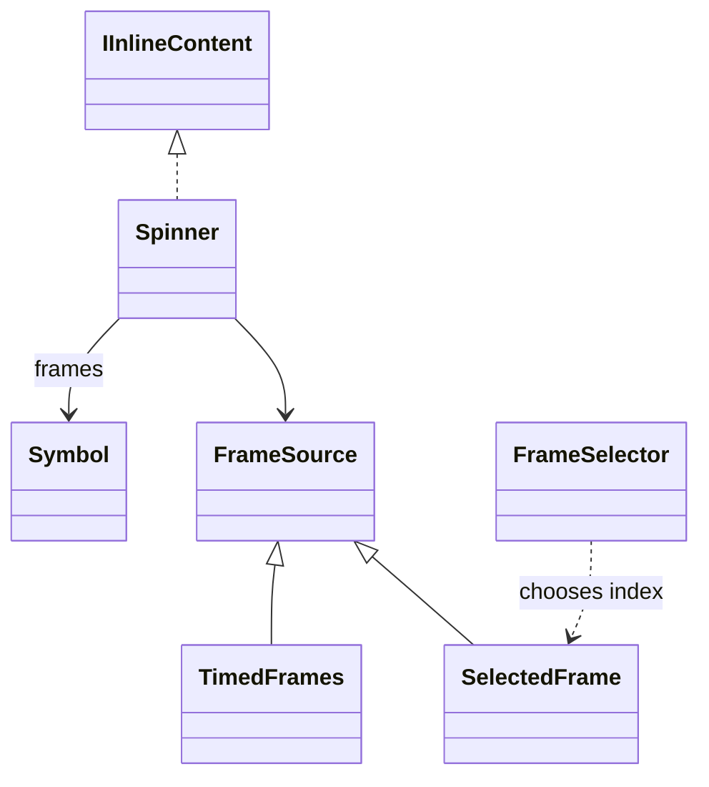

# Spinner

An inline activity animation with a default frame sequence. Frame selection can be temporal or driven by arbitrary consumer state.

## Usage

```csharp
new Line(
    new Spinner(new TimedFrames(100)),
    " Resolving dependencies").Show();
```

Constructing the description does not print. `Show` is the explicit output boundary; see [[docs/presentation/output/README|Output]].

## API contract

These are API extracts, not implementation bodies or a compiling source file.

```csharp
public delegate int FrameSelector<in TState>(TState state, int frameCount);
public abstract record FrameSource;
public sealed record TimedFrames : FrameSource
{
    public TimedFrames(int intervalMs = 100);
    public int IntervalMs { get; }
}
public sealed record SelectedFrame(int Index) : FrameSource
{
    public int Index { get; }
}

public sealed class Spinner : IInlineContent
{
    public Spinner(FrameSource? source = null);
    public Spinner(IEnumerable<Symbol> frames, FrameSource? source = null);
}
```

## Composition

Spinner is inline, unlike static Activity. Symbol frames contain no colour or timing. TimedFrames is one FrameSource; SelectedFrame supplies an explicit index. FrameSelector<TState> is a pure consumer function, not a scheduler.



## Behavior and validation

Frames are a nonempty captured sequence of one visible grapheme each, without spaces. Reserve maximum frame width. TimedFrames interval is a positive integer in milliseconds, default 100; zero is invalid. The SelectedFrame constructor retains its accepted named argument Index. SelectedFrame rejects negative indices at construction; Spinner validates the upper bound against its frame count. TimedFrames and SelectedFrame are sealed records with explicit validated constructors and get-only properties: no init/with mutation may bypass their invariants. Default source is timed; unsupported Unicode uses the owner ASCII sequence.

SelectedFrame retains positional deconstruction and the `Index` named argument. Its explicitly declared get-only positional property is initialized from the validated input; the contract extract omits that initialization and validation body. Positional notation does not permit replacing Index through `with`.

## Presentation

The preview shows the semantic arrangement. Browser rendering is illustrative; it does not verify terminal cell measurement.

### Colour tokens

| Part | Token |
|---|---|
| Frame | `accent.foreground` |

### Layout

Reserve frame space to keep adjacent text stable. It does not add a margin independently; enclosing task displays own progress-group spacing.

Shared wrapping, Unicode and control handling are defined in [[docs/presentation/text-and-layout|Text and layout]]. Automatic margins collapse by maximum; explicit [[docs/presentation/components/blank-line|BlankLine]] remains additional content.

## Preview

![[docs/assets/captures/spinner.png]]

[Open interactive preview](../../assets/previews/spinner.html)

### Preview source

```csharp
new Line(
    new Spinner(new TimedFrames(100)),
    " Resolving dependencies").Show();
```

## Live behavior

Construction starts no clock. While actively shown, temporal selection uses a monotonic clock. Close/Remove stop animation. Stable/no-motion output emits meaningful state rather than every frame. A consumer selector based on work count or connectivity runs where its state lives and supplies SelectedFrame; a non-temporal source does not require elapsed time.

## Customization

Supply Symbol frames and a source deliberately in code. The TOML does not expose frame cadence. Custom backend scheduling is separate from ordinary consumer frame selection.
