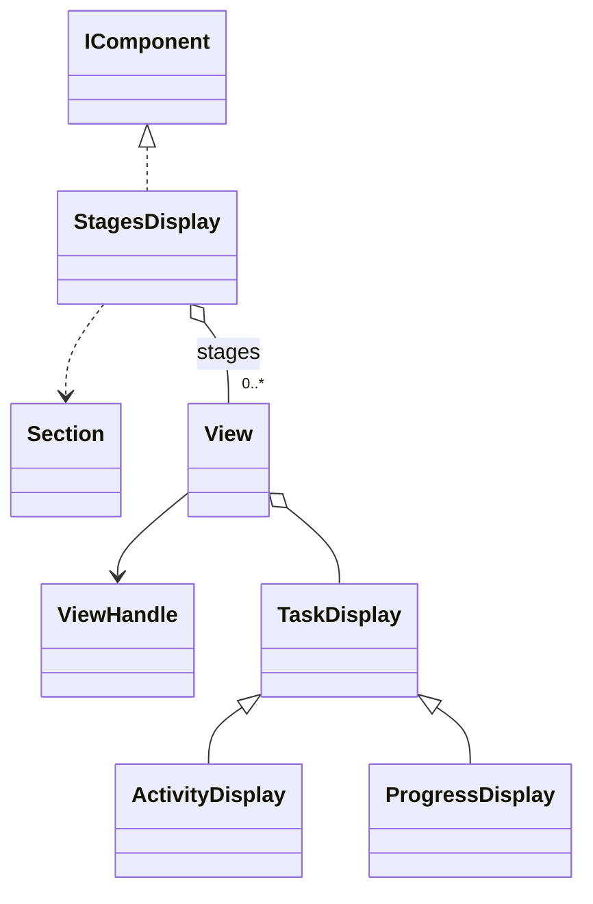

# StagesDisplay

An ordered task group with independently addressable stages, shown through one output call.

## Usage

```csharp
var stages = new StagesDisplay("Updating project",
    new ActivityDisplay("Resolve dependencies"),
    new ActivityDisplay("Download files", state: TaskState.Pending),
    new ActivityDisplay("Validate project", state: TaskState.Pending));
stages.Show();
stages.Stages[0].Handle.Update(new ActivityDisplay(
    "Resolve dependencies", state: TaskState.Succeeded));
```

Constructing the description does not print. `Show` is the explicit output boundary; see [[docs/presentation/output|Output]].

## API contract

These are API extracts, not implementation bodies or a compiling source file.

```csharp
public sealed class StagesDisplay : IComponent
{
    public StagesDisplay(string title, params TaskDisplay[] stages);
    public string Title { get; }
    public IReadOnlyList<View> Stages { get; }
}
```

## Composition

Composes a Section and one explicit child View per supplied TaskDisplay. Stages exposes ordered Views, allowing stage handle updates after mounting. It accepts ActivityDisplay and ProgressDisplay through TaskDisplay.



## Behavior and validation

Snapshot stage order and reject null entries. Title follows Section heading rules. Internally owned Views give each instance one placement lifetime. It never runs stages, infers dependencies or computes an equal-weight global percentage.

## Presentation

The preview shows the semantic arrangement. Browser rendering is illustrative; it does not verify terminal cell measurement.

### Colour tokens

| Part | Token |
|---|---|
| Heading | `title.foreground` |
| Rules and secondary detail | `subtext.foreground` |
| Stages | `Their task tokens` |

### Layout

Keep stages compact inside the group; request one lower gap after the complete group. Apply Section depth rules and shared narrow layout without adding margins between every stage.

Shared wrapping, Unicode and control handling are defined in [[docs/presentation/text-and-layout|Text and layout]]. Automatic margins collapse by maximum; explicit [[docs/presentation/components/blank-line|BlankLine]] remains additional content.

## Preview

![[docs/assets/captures/stages-display.png]]

[Open interactive preview](../../assets/previews/stages-display.html)

### Preview source

```csharp
var stages = new StagesDisplay("Updating project",
    new ActivityDisplay("Resolve dependencies"),
    new ActivityDisplay("Download files", state: TaskState.Pending),
    new ActivityDisplay("Validate project", state: TaskState.Pending));
stages.Show();
stages.Stages[0].Handle.Update(new ActivityDisplay(
    "Resolve dependencies", state: TaskState.Succeeded));
```

## Live behavior

Show once, then update Stages[index].Handle. A parent removal invalidates child handles. Retained identical child Views preserve identity during parent updates. Close freezes presentation; operation cancellation and success are application responsibilities.
