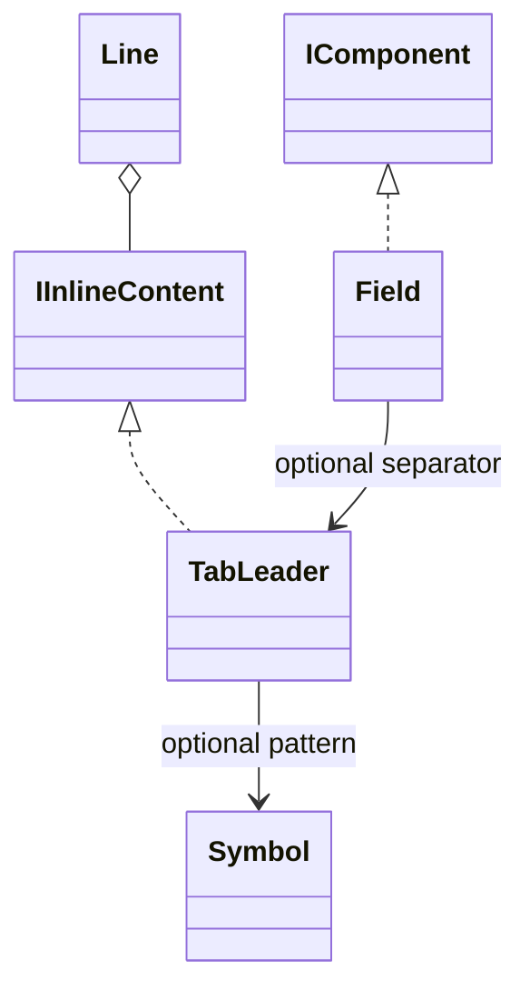

# TabLeader

An immutable alignment value that pads the logical line prefix to a target terminal-cell width, optionally using a repeated Symbol pattern. It implements IInlineContent and can separate pieces inside Line or serve as the separator of Field.

## Usage

```csharp
var dotted = new TabLeader(14, new Symbol("."));
Output.Show(
    new Field("Project", "demo", dotted),
    new Field("Files", "12", dotted),
    new Field("Project", "demo", new TabLeader(14)),
    new Line(new Text("Note"),
        new TabLeader(12, new Symbol("_-\\_")),
        new Text("Local")));
```

The two dotted values begin at the same target position. The third uses ordinary spaces. Construction does not print.

## API contract

These are API extracts; constructor validation bodies are deliberately omitted.

```csharp
public readonly record struct TabLeader : IInlineContent
{
    public TabLeader(int width, Symbol? symbol = null);
    public int Width { get; }
    public Symbol? Symbol { get; }
}
```

Width is the target cell width of the complete preceding logical prefix, not a number of pattern repetitions and not a Field label-width property. Symbol is optional: null means padding with ordinary spaces. Both properties are get-only; the constructor validates before retaining them. Generated record equality compares immutable values. Boxing through an object or interface may allocate; value representation makes no zero-allocation guarantee.

## Composition

TabLeader is an inline value component. Line places it among ordered pieces; Field also accepts it as its optional separator. The enclosing inline layout provides the entire preceding logical prefix and applies the shared terminal-cell width profile.



## Behavior and validation

- Width must be nonnegative. A negative width is invalid.
- A supplied Symbol must be valid, including rejecting an explicitly supplied default(Symbol). Null selects spaces.
- default(TabLeader) is valid: Width is zero and Symbol is null.
- Measure the entire preceding logical line content, including every content segment already emitted by the owner. Do not measure only the most recent text piece.
- Structural indentation supplied by enclosing layouts is excluded from that prefix measurement.
- When the prefix is shorter than Width, pad the remaining width. With Symbol, repeat only complete fitting graphemes; fill any remaining cells with ordinary spaces.
- If the prefix already reaches or exceeds Width, append at least one ordinary space. Do not truncate or move existing content.
- Preserve the complete resulting padding, including trailing spaces. Separator's rule trimming does not apply to TabLeader.

The owning inline layout performs measurement using the current output profile. Width is measured in terminal cells, not UTF-16 code units or string.Length.

## Presentation

The preview contrasts dotted padding with space padding. Browser geometry illustrates the alignment contract; it is not a production terminal-width engine.

### Colour tokens

| Part | Token |
|---|---|
| Pattern | `subtext.foreground` |
| Space padding | No visible colour of its own |

TabLeader introduces no new token. The owning component supplies the pattern's semantic token.

### Layout

The target is relative to the logical content origin. Nested Section indentation moves the whole result together without changing its relative alignment. A target cannot force output beyond the available width; wrapping and narrow-layout rules still apply. TabLeader does not request a lower margin.

Shared Unicode and control rules are defined in [[docs/presentation/text-and-layout|Text and layout]]. TabLeader never executes or interprets its pattern.

## Preview

![[docs/assets/captures/tab-leader.png]]

[Open interactive preview](../../assets/previews/tab-leader.html)

### Preview source

```csharp
var dotted = new TabLeader(14, new Symbol("."));
Output.Show(
    new Field("Project", "demo", dotted),
    new Field("Files", "12", dotted),
    new Field("Project", "demo", new TabLeader(14)),
    new Line(new Text("Note"),
        new TabLeader(12, new Symbol("_-\\_")),
        new Text("Local")));
```

The HTML also allows inspecting a target already reached, custom pattern fitting and prefix measurement. Those controls demonstrate the same value contract rather than a separate public rendering API.
