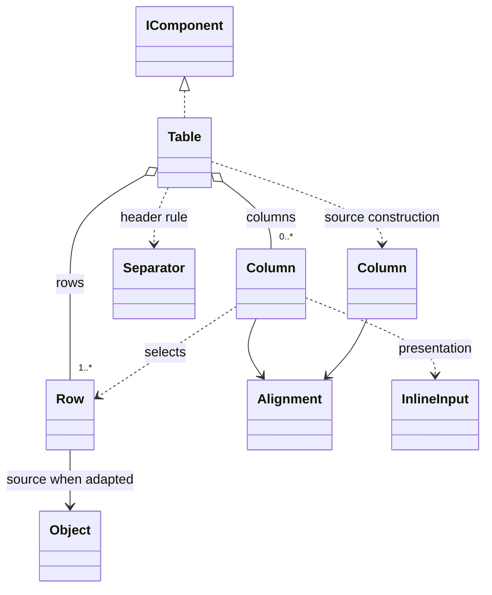

# Table

A row-oriented view with mandatory column headers and at least one data row. Columns select and present values; formatting never replaces the original data.

## Usage

```csharp
var table = new Table(
    ["Name", "Files"],
    new Row("demo", 12),
    new Row("test", 3));
table.Show();
```

Constructing the description does not print. Show is the explicit output boundary; see [[docs/presentation/output/README|Output]]. Columns precede rows in every construction form.

## API contract

These are API extracts, not implementation bodies or a compiling source file.

```csharp
public enum Alignment { Auto, Left, Right, Center }

public sealed class Row
{
    public Row(params IEnumerable<object?> values);
    public static Row FromFields(IReadOnlyDictionary<string, object?> fields);
    public int Count { get; }
    public IReadOnlyList<object?> Values { get; }
    public IReadOnlyList<string>? FieldNames { get; }
    public object? Source { get; }
    public object? this[int index] { get; }
    public object? this[string field] { get; }
    public bool TryGetValue(string field, out object? value);
}

public sealed class Column
{
    public Column(string header, int index,
        Func<object?, InlineInput>? presentation = null,
        Alignment alignment = Alignment.Auto);
    public Column(string header, string field,
        Func<object?, InlineInput>? presentation = null,
        Alignment alignment = Alignment.Auto);
    public static Column For<TValue>(string header, int index,
        Func<TValue, InlineInput> presentation,
        Alignment alignment = Alignment.Auto);
    public static Column For<TValue>(string header, string field,
        Func<TValue, InlineInput> presentation,
        Alignment alignment = Alignment.Auto);
    public string Header { get; }
    public int? Index { get; }
    public string? Field { get; }
    public Func<object?, InlineInput>? Presentation { get; }
    public Alignment Alignment { get; }
}

public sealed class Column<TData>
{
    public Column(string header, Func<TData, object?> value,
        Func<object?, InlineInput>? presentation = null,
        Alignment alignment = Alignment.Auto);
    public string Header { get; }
    public Func<TData, object?> Value { get; }
    public Func<object?, InlineInput>? Presentation { get; }
    public Alignment Alignment { get; }
}

public sealed class Table : IComponent
{
    public Table(IEnumerable<Column> columns, Row firstRow,
        params IEnumerable<Row> remainingRows);
    public Table(IEnumerable<Column> columns, IEnumerable<Row> rows);
    public Table(IEnumerable<string> columns, Row firstRow,
        params IEnumerable<Row> remainingRows);
    public Table(IEnumerable<string> columns, IEnumerable<Row> rows);
    public static Table From<TData>(IEnumerable<Column<TData>> columns,
        TData firstRow, params IEnumerable<TData> remainingRows);
    public static Table From<TData>(IEnumerable<Column<TData>> columns,
        IEnumerable<TData> rows);
    public IReadOnlyList<Row> Rows { get; }
    public IReadOnlyList<Column> Columns { get; }
}
```

## Composition

Table composes a header row, a default [[docs/presentation/components/separator|Separator]] and the data rows. Headers are required structural strings. String columns map labels to zero-based positional selectors. Explicit Column selects one index or field; Column<TData> reads an existing application object with a selector. These source descriptors do not require CLR reflection or property-name strings. From normalizes selected cell values into Rows and positional Columns, retaining each source object through Row.Source. Source is null for manually supplied positional/named Rows. Generic descriptors are construction inputs, not subclasses of Column or new table kinds. Internal helper names are implementation choices.



## Behavior and validation

Capture finite input sequences once, preserving order, without promising deep cloning. At least one non-null data row is required in every constructor and From call. The required firstRow prevents omission in variadic calls at compile time; an IEnumerable can only be checked for emptiness when captured. Reject an empty source before any output, including sources with valid headers. Reject null columns, rows, selectors and callbacks where required. The remainingRows collection can be empty. No params-only row overload admits a headers-only table.

Named fields compare exactly; missing differs from null. Positional selectors also read named Row values in their captured order. Rows must have the selected indices/fields but can have additional values; row length need not equal displayed column count. For<TValue> validates type compatibility without parsing numeric strings or silently converting types. Nullable value types permit null; reference annotations do not create a distinct runtime type. Report row and column for selection, conversion or presentation errors. Reject undefined Alignment values. Evaluate source selectors and presentation callbacks once per captured cell and reuse the results for measurement/output. InlineInput callback strings normalize to Text; null/default callback results are invalid.

A Row value may itself be an array or dictionary: do not flatten nested values recursively. When a collection is one positional cell, pass it as an object value rather than as the row's values collection. Empty displayed column sets retain original rows but produce no visible table; the nonempty-row invariant still applies.

## Presentation

The preview illustrates layout; it does not execute R3CLI or verify terminal-cell measurement.

### Colour tokens

| Part | Token |
|---|---|
| Headers and header rule | `subtext.foreground` |
| Default values | `text.foreground` |
| Null marker | `subtext.foreground` |
| Custom cells | Tokens of their inline components |

### Layout

Place exactly one ordinary Separator immediately below all wrapped header lines and above the data, with no intervening blank lines. Use continuous ─ (U+2500), or - in ASCII mode, across the complete laid-out width including column gaps. Do not add separate rules for each column. No rows means invalid input, not a header-only presentation.

Default values use the shared conversion policy in [[docs/presentation/composition|Composition]]: null shows null, an empty string remains empty, and other values use their ordinary ToString representation. Dates, durations and arrays are not expanded or reformatted implicitly. A callback can choose another representation without changing original data.

Alignment.Auto classifies the original selected values, ignoring null: number, text, boolean, date-time, duration, other or mixed. The numeric category covers the built-in integer/floating types, decimal and BigInteger; date-time covers DateTime, DateTimeOffset, DateOnly and TimeOnly; duration covers TimeSpan. Custom objects are other unless their original supported logical type is a native-adapter numeric/date/duration category. All-numeric CLR values form the number category even when numeric runtime types differ; numeric strings remain text. Other heterogeneous categories use mixed; no non-null values uses other. A custom presentation does not change this classification. Explicit Left/Right/Center overrides configuration. Auto uses the corresponding [[docs/configuration/toml|TOML policy]]. Headers independently use the configured left/center/right alignment inside their calculated column widths; the default is center, not an instruction to follow cell alignment. Column width includes both header and presented cells.

Cells may wrap or contain permitted explicit breaks; row height is the tallest cell. Align wrapped cell lines within their column widths. Column minimum is min(natural width, 8 cells). If minimums plus gaps do not fit, render labelled vertical records, preserving labels and order, without a shared header rule. Request one lower gap after the whole table. Shared Unicode, wrapping and margins are defined in [[docs/presentation/text-and-layout|Text and layout]].

## Preview

![[docs/assets/captures/table.png]]

[Open interactive preview](../../assets/previews/table.html)

### Preview source

```csharp
Row[] rows = [new("README.md", 2048L), new("main.cs", 1024L)];
var detailed = new Table(
    [new Column("Name", index: 0),
     Column.For<long>("Size", index: 1,
         presentation: bytes => new Subtext($"{bytes / 1024} KiB"))],
    rows);
var compact = new Table(["Name", "Bytes"], rows);
Output.Show(detailed, compact);
```

## Structured data

Presentation never removes unselected values or changes original field names. Formatted 2 KiB retains the numeric 2048L. Header rules and alignment add no domain rows or fields. Source objects remain distinct from selected display values; computed selectors do not invent source field names. Native adapters accept arrays and records without manual CLR Row construction, and retain source logical types. Arbitrary Row.Source objects are not automatically serializable; [[docs/questions/adapter-transport|Adapter transport]] owns the portable value profile. Never reconstruct original data by parsing formatted cells.

## Customization

```csharp
var named = Row.FromFields(new Dictionary<string, object?>
{
    ["name"] = "demo",
    ["files"] = 12,
    ["directory"] = "D:/Projects/demo"
});
var table = new Table(
    [new Column("Project", field: "name"),
     new Column("Files", field: "files", alignment: Alignment.Right)],
    named);
```

Column presentation can return a string, normalized to Text, or explicit inline content such as Subtext. The same name, presentation, is used by Tree.From and TreeNode.Presentation for the mapping from original data to visual descriptions.

## Additional examples

```csharp
Project[] projects = [new("demo", 12, "D:/Projects/demo")];
var table = Table.From(
    [new Column<Project>("Project", project => project.Name),
     new Column<Project>("Files", project => project.Files,
         presentation: value => new Subtext(value))],
    projects);

// Application model, not an R3CLI type.
public sealed record Project(string Name, int Files, string Directory);
```

Rows retain the source Project, including Directory, independently of selected columns. Typed empty column collections disambiguate the Column/string overloads; a bare [] or null can be ambiguous. A typed null is invalid. Use an application message for an empty result instead of constructing an invalid Table. Query emptiness cannot in general be proved by the compiler; adapters enforce the same nonempty-row rule.
