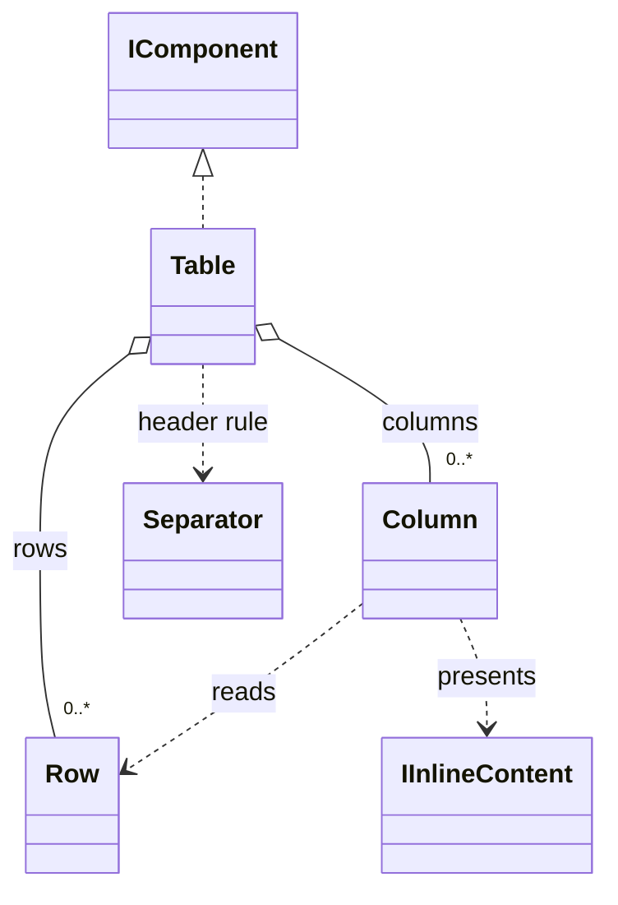

# Table

A row-oriented data view. Row preserves values; Column selects and presents a value from each row. Human formatting never replaces original data.

## Usage

```csharp
Row[] rows = [new Row("README.md", 2048L), new Row("main.cs", 1024L)];
var detailed = new Table(rows,
    new Column("Name", index: 0),
    Column.For<long>("Size", index: 1,
        presentation: bytes => new Subtext($"{bytes / 1024} KiB")));
var compact = new Table(rows, ["Name", "Bytes"]);
Output.Show(detailed, compact);
```

Constructing the description does not print. `Show` is the explicit output boundary; see [[docs/presentation/output|Output]].

## API contract

These are API extracts, not implementation bodies or a compiling source file.

```csharp
public sealed class Row
{
    public Row(params object?[] values);
    public static Row FromFields(IReadOnlyDictionary<string, object?> fields);
    public int Count { get; }
    public IReadOnlyList<object?> Values { get; }
    public IReadOnlyList<string>? FieldNames { get; }
    public object? this[int index] { get; }
    public object? this[string field] { get; }
    public bool TryGetValue(string field, out object? value);
}

public sealed class Column
{
    public Column(string header, int index,
        Func<object?, IInlineContent>? presentation = null);
    public Column(string header, string field,
        Func<object?, IInlineContent>? presentation = null);
    public static Column For<TValue>(string header, int index,
        Func<TValue, IInlineContent> presentation);
    public static Column For<TValue>(string header, string field,
        Func<TValue, IInlineContent> presentation);
    public string Header { get; }
    public int? Index { get; }
    public string? Field { get; }
    public Func<object?, IInlineContent>? Presentation { get; }
}

public sealed class Table : IComponent
{
    public Table(IEnumerable<Row> rows, params Column[] columns);
    public Table(IEnumerable<Row> rows, IEnumerable<string> columns);
    public IReadOnlyList<Row> Rows { get; }
    public IReadOnlyList<Column> Columns { get; }
}
```

## Composition

Rows are data and columns are selectors, not separate lists of cells. Table composes the mandatory header row, a default [[docs/presentation/components/separator|Separator]] and the data rows; callers do not supply this separator. Header is mandatory. A column selects exactly one field or index, established by its constructor. The string-column constructor maps each mandatory header to its zero-based positional column, using the same access and validation as an explicit Column(header, index). Rows are the first parameter in both overloads. Internal lookup, validation and cell-layout helper methods are implementation choices, not fixed API contracts; sealed types require no protected API.



## Behavior and validation

Snapshot input containers without promising arbitrary deep cloning. Both Table constructors use identical row validation. Positional columns also work on named Row values in their captured order. Rows need every selected index or field, but may contain additional unselected values; do not require an exact row length equal to the displayed column count. Named fields compare exactly; missing differs from null. Validate absent fields/indices and type compatibility before output, reporting row and column. For<TValue> returns an ordinary Column. Do not parse numeric strings or silently convert types. Nullable value types allow null; reference annotations do not create a distinct runtime type. Evaluate presentation once per cell snapshot and reuse it for layout.

## Presentation

The preview shows the semantic arrangement. Browser rendering is illustrative; it does not verify terminal cell measurement.

### Colour tokens

| Part | Token |
|---|---|
| Default headers | `subtext.foreground` |
| Header separator | `subtext.foreground` |
| Default values | `text.foreground` |
| Custom cells | `Tokens of their inline components` |

### Layout

By default, render exactly one ordinary Separator immediately below the complete header row, using the continuous Unicode pattern ─ (U+2500), or - in ASCII mode. It spans the full laid-out table width, including the gaps between columns, rather than adding a separate rule per column. There is no blank line between headers, rule and data. Wrapped headers finish before the rule. Both constructors share this presentation; no new constructor argument or colour token is needed. An empty table with visible columns still shows its headers and rule; an empty visible projection shows neither. In the labelled vertical-record fallback there is no shared header row, so no header rule is emitted.

Cells can wrap or contain permitted explicit breaks; row height is the tallest cell. Column minimum is min(natural width, 8 cells). If minimums plus gaps do not fit, render labelled vertical records, preserving labels and order. Request one lower gap after the complete table.

Shared wrapping, Unicode and control handling are defined in [[docs/presentation/text-and-layout|Text and layout]]. Automatic margins collapse by maximum; explicit [[docs/presentation/components/blank-line|BlankLine]] remains additional content.

## Preview

![[docs/assets/captures/table.png]]

[Open interactive preview](../../assets/previews/table.html)

### Preview source

```csharp
Row[] rows = [new Row("README.md", 2048L), new Row("main.cs", 1024L)];
var detailed = new Table(rows,
    new Column("Name", index: 0),
    Column.For<long>("Size", index: 1,
        presentation: bytes => new Subtext($"{bytes / 1024} KiB")));
var compact = new Table(rows, ["Name", "Bytes"]);
Output.Show(detailed, compact);
```

## Structured data

The header rule is human presentation only; it adds no row, field or value to Nushell or PowerShell structured output. Rows retain supported original values and field names independently of headers and presentation. The numeric value 2048L stays numeric when its cell reads 2 KiB. Displayed columns do not implicitly project away unselected fields. Adapters accept native rows/records and build these descriptions internally. See [[docs/integration/adapter-boundaries|Adapter boundaries]].

## Customization

Column presentation accepts an inline descriptor. Use For<TValue> in C# to avoid casts; foreign adapters evaluate their own callbacks. A callback does not cross processes as an arbitrary CLR delegate.

```csharp
var row = Row.FromFields(new Dictionary<string, object?>
{
    ["name"] = "demo",
    ["files"] = 12
});
var namedTable = new Table([row],
    new Column("Name", field: "name"),
    new Column("Files", field: "files"));
```

## Additional examples

Use a typed empty collection when intentionally choosing an empty column set. A bare [] or null is ambiguous between the two overloads; a typed null still fails validation.

```csharp
var noExplicitColumns = new Table(rows, Array.Empty<Column>());
var noStringColumns = new Table(rows, Array.Empty<string>());
```

The overload does not discard row values. Empty columns mean an empty visible projection; original rows remain available through Rows. Selecting a subset of columns likewise keeps unselected values.
