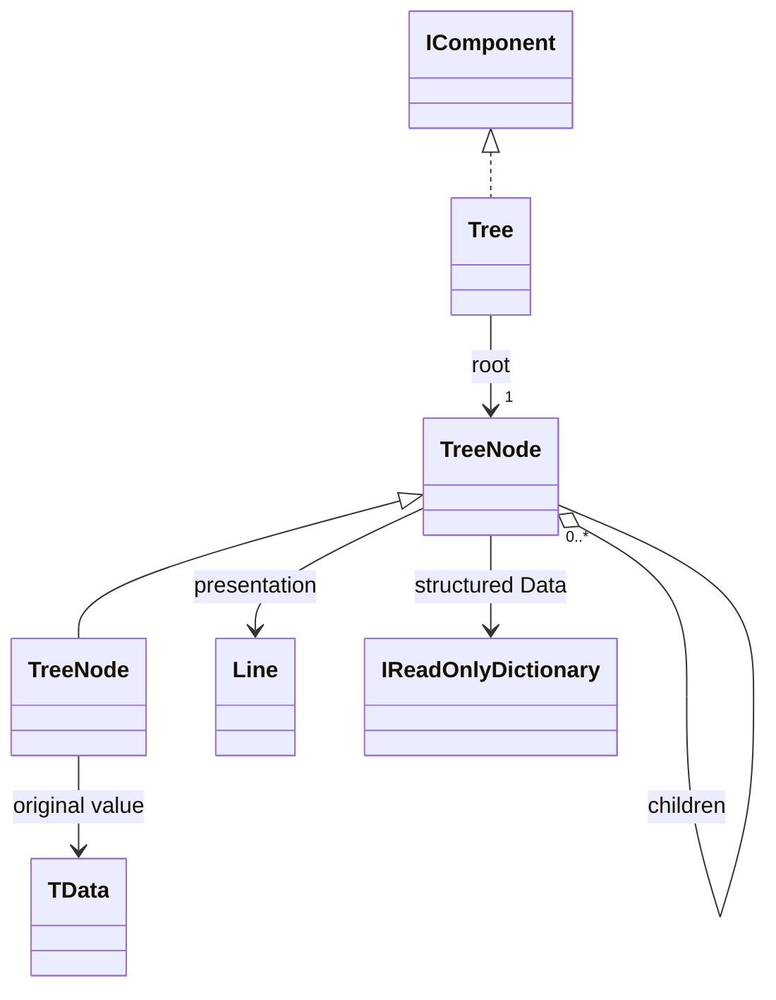

# Tree

A visual hierarchy with one required visible root. Nodes retain original data, define children and provide their own Line presentation.

## Usage

```csharp
var root = new FileEntry("project", null,
[
    new FileEntry("src", null,
    [
        new FileEntry("main.cs", 1200, []),
        new FileEntry("config.cs", 800, [])
    ]),
    new FileEntry("README.md", 2048, [])
]);

Tree.From(root,
    data: entry => new Dictionary<string, object?>
    {
        ["name"] = entry.Name,
        ["size"] = entry.Size,
        ["kind"] = entry.Size is null ? "directory" : "file"
    },
    children: entry => entry.Children,
    presentation: entry => new Line(
        entry.Name + (entry.Size is null ? "/" : ""),
        new Subtext(entry.Size is long size ? $"  {size} B" : "")))
    .Show();

// Consumer model declaration; not an R3CLI type.
public sealed record FileEntry(string Name, long? Size, FileEntry[] Children);
```

Constructing the description does not print. `Show` is the explicit output boundary; see [[docs/presentation/output/README|Output]].

## API contract

These are API extracts, not implementation bodies or a compiling source file.

```csharp
public abstract class TreeNode
{
    public abstract IReadOnlyDictionary<string, object?> Data { get; }
    public abstract IReadOnlyList<TreeNode> Children { get; }
    public abstract int? MaxChildren { get; }
    public abstract Line Presentation { get; }
}

public abstract class TreeNode<TData>(TData value) : TreeNode
{
    public TData Value { get; } = value;
}

public sealed class Tree : IComponent
{
    public Tree(TreeNode root);
    public TreeNode Root { get; }
    public static Tree From<TData>(TData root,
        Func<TData, IReadOnlyDictionary<string, object?>> data,
        Func<TData, IEnumerable<TData>> children,
        Func<TData, Line> presentation);
}
```

## Composition

TreeNode is not IComponent; Tree supplies its position and connectors. TreeNode<TData> retains the typed original object in Value. Data independently declares named structured fields, not the original object or its formatted label. Consumer subclasses can be heterogeneous. There is no public concrete Node, no invisible root and no forest constructor. From is the short path for existing nested data: its required data, children and presentation selectors receive the current source object during construction. The lambda parameter name is chosen by the caller. No selector runs on repaint; no reflection invents fields. Its presentation callback and TreeNode.Presentation consistently name the mapping from original data to the displayed Line; data and children do not change when that line is formatted.



## Behavior and validation

On first use by Tree construction, capture each node's finite child sequence, Data fields and Presentation once. Each node owns and reuses its capture across trees. Preserve child order. Do not invoke virtual node properties from the base constructor or publish an incomplete capture; concurrent capture must not expose partial state. A failed attempt does not establish a successful capture. Consumers supply side-effect-free properties/selectors; this is not a transactional rollback of their code.

MaxChildren null means unbounded, zero means leaf, a positive value is a maximum; negative is invalid. Validate cycles, limits and repeated positions before emitting. Every Tree validates its structure even when captures already exist. One TreeNode instance cannot occupy two positions in one tree; distinct nodes may hold equal data. Root returns the original node, preserving its identity and subtype. Capture children as original node references, not a second hierarchy of captured nodes. See [[docs/presentation/architecture/model-and-construction|Model and construction]] for internal contracts.

Data is non-null; an empty dictionary is valid. Capture keys with ordinal, case-sensitive comparison, preserving spelling. Missing differs from null. Copy the field mapping without deep-cloning values. Value retains the original typed source when the generic base is used. Changing the original object or its getters does not refresh a captured node. Construct replacement nodes to obtain a new capture; replacing a Tree with the same nodes reuses their captures. From rejects null selectors and null returned mappings, child sequences or presentations. Its generated nodes keep source values without requiring a public concrete node class.

## Presentation

The preview shows the semantic arrangement. Browser rendering is illustrative; it does not verify terminal cell measurement.

### Colour tokens

| Part | Token |
|---|---|
| Connectors | `subtext.foreground` |
| Node line | `Tokens of its inline pieces` |

### Layout

Use │ U+2502, ─ U+2500, ├ U+251C and └ U+2514 consistently. Each level uses four cells: ancestor │ plus three spaces, or four spaces; branch prefixes are ├── and └── followed by a space. Root has no prefix. Wrapped continuations retain ancestor verticals without repeating the node junction. Compact indentation at narrow widths; if no branch plus content fits, use linear traversal. Request one lower gap after the complete tree.

Shared wrapping, Unicode and control handling are defined in [[docs/presentation/text-and-layout|Text and layout]]. Automatic margins collapse by maximum; explicit [[docs/presentation/components/blank-line|BlankLine]] remains additional content.

## Preview

![[docs/assets/captures/tree.png]]

[Open interactive preview](../../assets/previews/tree.html)

### Preview source

```csharp
var root = new FileEntry("project", null,
[
    new FileEntry("src", null,
    [
        new FileEntry("main.cs", 1200, []),
        new FileEntry("config.cs", 800, [])
    ]),
    new FileEntry("README.md", 2048, [])
]);

Tree.From(root,
    data: entry => new Dictionary<string, object?>
    {
        ["name"] = entry.Name,
        ["size"] = entry.Size,
        ["kind"] = entry.Size is null ? "directory" : "file"
    },
    children: entry => entry.Children,
    presentation: entry => new Line(
        entry.Name + (entry.Size is null ? "/" : ""),
        new Subtext(entry.Size is long size ? $"  {size} B" : "")))
    .Show();

// Consumer model declaration; not an R3CLI type.
public sealed record FileEntry(string Name, long? Size, FileEntry[] Children);
```

## Structured data

Data is the declared string-keyed field mapping. Arrays, dictionaries, scalars and consumer objects may be field values or the typed original Value; they do not replace the mapping itself. A collection stored as a field does not automatically create Children. Already nested data uses From; flat identity/parent input needs explicit relation construction. Grouping nodes need not represent original table rows. Adapters export captured fields and relationships rather than rereading mutable original getters or parsing labels. Retain supported field values and their logical types; the captured dictionary does not make arbitrary objects serializable. Captured fields can feed Row.FromFields without recovering data from text. The portable value profile and transport remain a separate decision: [[docs/questions/adapter-transport|Portable adapter transport]]. [[docs/integration/adapter-boundaries|Adapter boundaries]] defines the responsibility split, not a finished serialization protocol.

## Customization

Subclass TreeNode<TData> when a reusable node kind owns child limits or a specialized line. Use Tree.From when selectors suffice. Both approaches explicitly declare the structured Data mapping. Build replacement nodes and a replacement description, then Update the existing output handle to show changed data.
