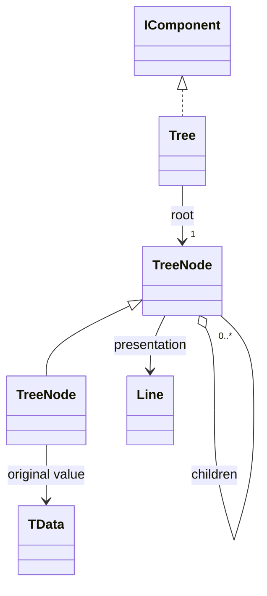

# Tree

A visual hierarchy with one required visible root. Nodes retain original data, define children and provide their own Line presentation.

## Usage

```csharp
var root = new FileEntry("project", null,
[
    new FileEntry("src", null,
    [
        new FileEntry("main.cs", 1200, []),
        new FileEntry("config.cs", 800, [])
    ]),
    new FileEntry("README.md", 2048, [])
]);

Tree.From(root,
    children: entry => entry.Children,
    presentation: entry => new Line(
        entry.Name + (entry.Size is null ? "/" : ""),
        new Subtext(entry.Size is long size ? $"  {size} B" : "")))
    .Show();

// Consumer model declaration; not an R3CLI type.
public sealed record FileEntry(string Name, long? Size, FileEntry[] Children);
```

Constructing the description does not print. `Show` is the explicit output boundary; see [[docs/presentation/output|Output]].

## API contract

These are API extracts, not implementation bodies or a compiling source file.

```csharp
public abstract class TreeNode
{
    public abstract object? Data { get; }
    public abstract IReadOnlyList<TreeNode> Children { get; }
    public abstract int? MaxChildren { get; }
    public abstract Line Presentation { get; }
}

public abstract class TreeNode<TData>(TData value) : TreeNode
{
    public TData Value { get; } = value;
    public sealed override object? Data => Value;
}

public sealed class Tree : IComponent
{
    public Tree(TreeNode root);
    public TreeNode Root { get; }
    public static Tree From<TData>(TData root,
        Func<TData, IEnumerable<TData>> children,
        Func<TData, Line> presentation);
}
```

## Composition

TreeNode is not IComponent; Tree supplies its position and connectors. TreeNode<TData> gives typed Value and heterogeneous Data access to the same object. Consumer subclasses can be heterogeneous. There is no public concrete Node, no invisible root and no forest constructor. From is the short path for existing nested data. Its presentation callback and TreeNode.Presentation consistently name the mapping from original data to the displayed Line; data and children do not change when that line is formatted.



## Behavior and validation

Capture finite child structure at construction and evaluate presentation once per node snapshot. Preserve order. MaxChildren null means unbounded, zero means leaf, a positive value is a maximum; negative is invalid. Validate cycles, limits and ownership before emitting. One TreeNode instance cannot occupy two positions in one tree; distinct nodes may hold equal data. Preserve original objects without promising deep cloning; supply stable data or snapshots.

## Presentation

The preview shows the semantic arrangement. Browser rendering is illustrative; it does not verify terminal cell measurement.

### Colour tokens

| Part | Token |
|---|---|
| Connectors | `subtext.foreground` |
| Node line | `Tokens of its inline pieces` |

### Layout

Use │ U+2502, ─ U+2500, ├ U+251C and └ U+2514 consistently. Each level uses four cells: ancestor │ plus three spaces, or four spaces; branch prefixes are ├── and └── followed by a space. Root has no prefix. Wrapped continuations retain ancestor verticals without repeating the node junction. Compact indentation at narrow widths; if no branch plus content fits, use linear traversal. Request one lower gap after the complete tree.

Shared wrapping, Unicode and control handling are defined in [[docs/presentation/text-and-layout|Text and layout]]. Automatic margins collapse by maximum; explicit [[docs/presentation/components/blank-line|BlankLine]] remains additional content.

## Preview

![[docs/assets/captures/tree.png]]

[Open interactive preview](../../assets/previews/tree.html)

### Preview source

```csharp
var root = new FileEntry("project", null,
[
    new FileEntry("src", null,
    [
        new FileEntry("main.cs", 1200, []),
        new FileEntry("config.cs", 800, [])
    ]),
    new FileEntry("README.md", 2048, [])
]);

Tree.From(root,
    children: entry => entry.Children,
    presentation: entry => new Line(
        entry.Name + (entry.Size is null ? "/" : ""),
        new Subtext(entry.Size is long size ? $"  {size} B" : "")))
    .Show();

// Consumer model declaration; not an R3CLI type.
public sealed record FileEntry(string Name, long? Size, FileEntry[] Children);
```

## Structured data

Arrays, dictionaries, scalars and consumer objects can be node data. An array appearing in Data is not automatically Children. Already nested data uses From; flat identity/parent input needs explicit relation construction. Grouping nodes need not represent original table rows. Preserve hierarchy and original values separately from connectors and display labels. The portable value profile and transport remain a separate decision: [[docs/questions/adapter-transport|Portable adapter transport]]. [[docs/integration/adapter-boundaries|Adapter boundaries]] defines the responsibility split, not a finished serialization protocol.

## Customization

Subclass TreeNode<TData> when a reusable node kind owns child limits or a specialized line. Use Tree.From when selectors suffice. Neither approach forces an IReadOnlyDictionary conversion. Build a replacement description and Update its existing output handle to show changed data.
