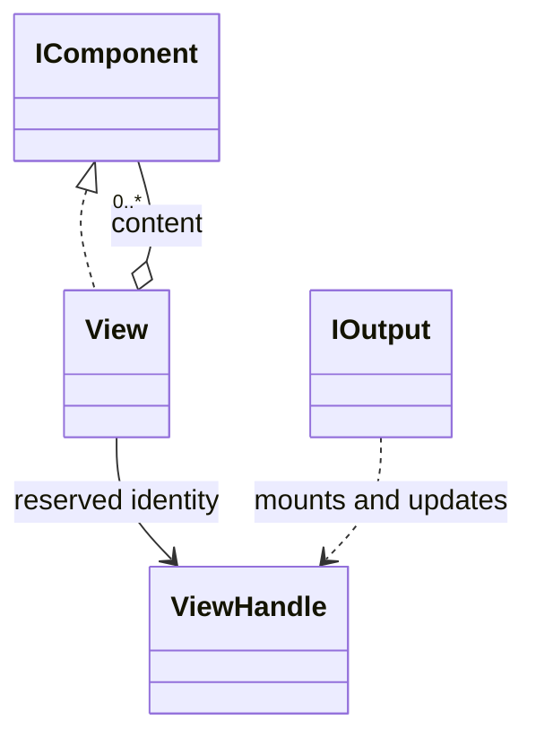

# View

An explicitly identified group of ordered components. It supplies a single placement lifetime without putting handles on all components.

## Usage

```csharp
var summary = new View(new Field("Files", 12));
var group = new View(new Title("Project report"), summary);
var handle = group.Show();
summary.Handle.Update(new Field("Files", 25));
handle.Close();
```

Constructing the description does not print. `Show` is the explicit output boundary; see [[docs/presentation/output|Output]].

## API contract

These are API extracts, not implementation bodies or a compiling source file.

```csharp
public sealed class View : IComponent
{
    public View(params IEnumerable<ComponentInput> content);
    public View(IEnumerable<IComponent> content);
    public IReadOnlyList<IComponent> InitialContent { get; }
    public ViewHandle Handle { get; }
}

public sealed class ViewHandle
{
    internal ViewHandle();
}
```

## Composition

View accepts strings as Text and arbitrary ordered IComponent children, including nested Views. Ordinary reusable descriptions have no handle; an explicit View reserves one. Show also returns a root handle covering its arguments.



## Behavior and validation

Normalize input strings to Text; reject null/default inputs. Existing component sequences use the collection overload without element wrapping. Empty calls select the variadic overload; use a typed collection for explicit empty sequences. Snapshot InitialContent. Reserved handles become usable after mounting. A View has one placement lifetime and cannot form cycles. Updating replaces content, returns the same handle and preserves explicitly retained identical child Views. Removed child Views are invalidated.

## Presentation

The preview shows the semantic arrangement. Browser rendering is illustrative; it does not verify terminal cell measurement.

### Colour tokens

This component owns no colour token; its children retain theirs.

### Layout

View owns no visible styling or independent gap. Its children retain their layout and collapsed margins; updating the group does not append separation repeatedly.

Shared wrapping, Unicode and control handling are defined in [[docs/presentation/text-and-layout|Text and layout]]. Automatic margins collapse by maximum; explicit [[docs/presentation/components/blank-line|BlankLine]] remains additional content.

## Preview

![[docs/assets/captures/view.png]]

[Open interactive preview](../../assets/previews/view.html)

### Preview source

```csharp
var summary = new View(new Field("Files", 12));
var group = new View(new Title("Project report"), summary);
var handle = group.Show();
summary.Handle.Update(new Field("Files", 25));
handle.Close();
```

## Live behavior

The capture shows the initial Show snapshot. The Update control corresponds to replacing Files 12 with Files 25; Close has no distinct visual appearance and freezes the region. Update can clear an active region with no replacement items. Close stops animation and does not mean success. Remove erases the owned editable region and invalidates descendants, even after Close while the representation remains owned. Repeated known Close/Remove are no-ops; updating a closed/removed handle fails. Neither operation can erase arbitrary terminal history or another application output. See [[docs/presentation/output|Output]] for the owner-bound facade.

## Additional examples

```csharp
var summary = new View("Project ready", new Field("Files", 12));
IEnumerable<IComponent> blocks = [new Title("Report"), summary];
var report = new View(blocks);
```

Strings become Text, never Subtext. The input union is not stored as part of the mounted View identity.
