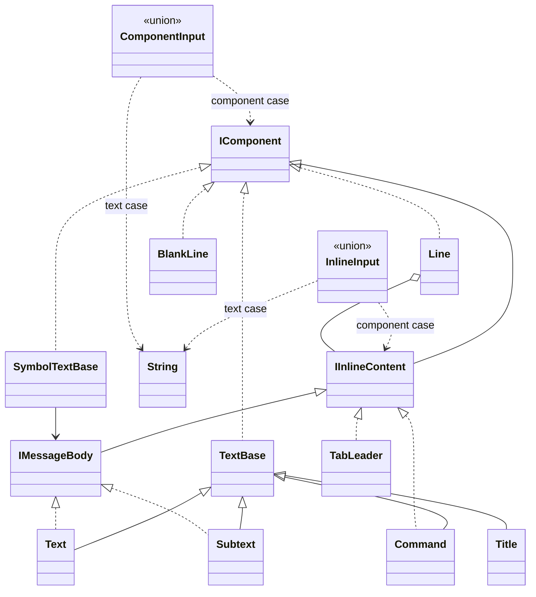

# Composition

Components are descriptions. Construction neither writes terminal bytes nor starts commands, clocks or tasks.

## Responsibilities

Define which descriptions can be shown, joined inline or used as a message body. Shared layout, output sessions and domain-data conversion belong to their own contracts.

## API contract

```csharp
public interface IComponent { }
public interface IInlineContent : IComponent { }
public interface IMessageBody : IInlineContent
{
    string Value { get; }
}

// Authoring input types; normalize to the component interfaces.
public union InlineInput(IInlineContent, string);
public union ComponentInput(IComponent, string);

// Authoring foundations; not direct user-created generic components.
public abstract class TextBase(object? value) : IComponent
{
    public object? OriginalValue { get; }
    public Type? OriginalType { get; }
    public string Value { get; }
}

public abstract class SymbolTextBase(IMessageBody body) : IComponent
{
    public IMessageBody Body { get; }
}
```

Primary-constructor parameters are camelCase inputs, not automatically exposed properties. Value and Body remain explicitly declared get-only properties; the actual constructor validates before retaining them. These extracts omit the validation bodies. The foundations identify shared members; their exact protected customization spelling is not a new accepted extension API. Ordinary custom composition reuses supported components. A marker interface alone does not register an arbitrary renderer.

## Rules

| Kind | Members |
|---|---|
| Text message bodies and inline pieces | Text, Subtext |
| Other inline pieces | Command, Spinner, TabLeader, help syntax pieces |
| Block-only descriptions | Title, Line, BlankLine, messages, Field, Section, Banner, LiteralBlock, Table, Tree, Diagnostic, Help, View, progress displays |
| Argument values, not components | Symbol, Row, Column, TreeNode, TaskProgress, FrameSource |
| Output services, not components | Output, OutputScope |

BlankLine cannot be placed in Line. Line itself is not inline. A standard message accepts IMessageBody, not an arbitrary IComponent.

## Class diagram



## String convenience and reuse

Strings in visual-content positions normalize to Text. The C# 15 input unions accept either a string or the corresponding component interface; they are constructor arguments, not components or stored children. Normalize immediately and expose the existing component interfaces in properties. A null string, null component or default union is invalid. BlankLine cannot enter InlineInput, but is valid ComponentInput.

Only string -> Text has a user-defined implicit conversion. Subtext always requires explicit construction. Structural strings such as headers, field names, codes and Symbol patterns retain their structural role. Input union conversion is separate from Text's implicit operator: it allows strings at interface-based composition boundaries.

Variadic sequences use params IEnumerable<T>. Capture and validate each finite sequence once; do not retain a deferred query for rendering. Collection overloads accept existing IEnumerable<IComponent> or IEnumerable<IInlineContent> without caller-side wrapping. A typed empty collection selects the intended overload; a bare [] may require a target type. Empty Show/Update and Line/View construction retain their documented meanings. Mixing a sequence into a variadic list does not implicitly flatten it.

TextBase retains the original object reference and its runtime type, and captures ToString() once on construction. Null renders as "null" and has no OriginalType; a null ToString result becomes empty text. ToString exceptions fail description construction with the source type and cause. Ordinary .NET objects inherit ToString; a type-name result is valid and is not automatically expanded. Formatting follows the value's normal current-culture behavior. Later object mutation does not change captured Value; retaining a reference does not promise deep cloning. Apply each component's Unicode/control/line rules after conversion. Arrays and dictionaries are not recursively expanded into text. Field and default table cells use this same conversion policy. Native adapters preserve their source logical types rather than claiming all values originated in .NET.

Descriptions normally snapshot their child sequences and are reusable. [[docs/presentation/architecture/model-and-construction|Model and construction]] defines ContentCapture, CapturedTable and node-owned CapturedTreeNode internals. A node reuses its first successful capture across trees; construct replacement nodes for changed data. Explicit View identity has a single placement lifetime; see [[docs/presentation/components/view|View]]. Colours belong to semantic pieces and survive composition. Build requirements are defined in [[docs/integration/build-baseline|Build baseline]].

## Example

```csharp
var content = new Section("Project",
    new Line("Name: ", new Command("demo")),
    new BlankLine(),
    new Info(new Subtext("Local configuration")));
content.Show();
```

## Representation

Small immutable values with useful structural equality use readonly record structs: Symbol, TabLeader and TaskProgress. Validated constructors and get-only properties preserve their invariants; positional init properties are not introduced just to shorten the declaration. Value-type defaults have explicit documented meanings.

Simple text/message descriptors remain classes and use primary constructors where that makes the input clearer. Row, Column, Table, Line, Section, Tree, Help, View, ViewHandle and StagesDisplay remain classes: collections, composition, specialization and placement identity do not become clearer merely by changing their representation. FrameSource is an abstract record, with validated sealed-record source descriptions. Output is a static facade over scoped internal sessions; OutputScope is a sealed lifetime owner borrowing a .NET TextWriter. Spectre.Console supplies internal rendering and detection, without becoming a public component base.

Value semantics do not promise zero allocations: boxing a value through object/interface storage can allocate. Consumer callbacks, terminal ownership and adapter serialization are separate concerns from C# representation.
