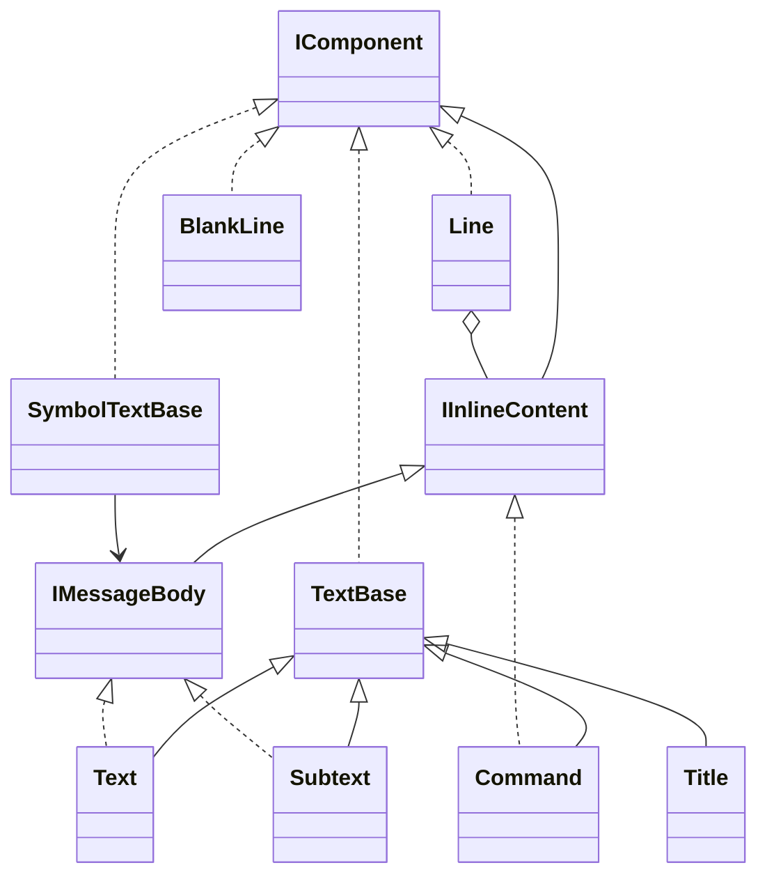

# Composition

Components are descriptions. Construction neither writes terminal bytes nor starts commands, clocks or tasks.

## Responsibilities

Define which descriptions can be shown, joined inline or used as a message body. Shared layout, output sessions and domain-data conversion belong to their own contracts.

## API contract

```csharp
public interface IComponent { }
public interface IInlineContent : IComponent { }
public interface IMessageBody : IInlineContent
{
    string Value { get; }
}

// Authoring foundations; not direct user-created generic components.
public abstract class TextBase : IComponent
{
    public string Value { get; }
}

public abstract class SymbolTextBase : IComponent
{
    public IMessageBody Body { get; }
}
```

The foundations identify shared members; their exact protected customization spelling is not a new accepted extension API. Ordinary custom composition reuses supported components. A marker interface alone does not register an arbitrary renderer.

## Rules

| Kind | Members |
|---|---|
| Text message bodies and inline pieces | Text, Subtext |
| Other inline pieces | Command, Spinner, help syntax pieces |
| Block-only descriptions | Title, Line, BlankLine, messages, Field, Section, Banner, LiteralBlock, Table, Tree, Diagnostic, Help, View, progress displays |
| Argument values, not components | Symbol, Row, Column, TreeNode, TaskProgress, FrameSource |
| Output services, not components | IOutput, Output, StableOutput |

BlankLine cannot be placed in Line. Line itself is not inline. A standard message accepts IMessageBody, not an arbitrary IComponent.

## Class diagram



## String convenience and reuse

Strings in visual-content positions mean Text. This is a binding/API convenience, not a claim that a C# implicit conversion to an interface works automatically. Structural strings such as headers, field names, codes and Symbol patterns keep their structural role. Examples use explicit Text at interface positions.

Descriptions normally snapshot their child sequences and are reusable. Explicit View identity has a single placement lifetime; see [[docs/presentation/components/view|View]]. Colours belong to semantic pieces and survive composition, rather than being inherited indiscriminately from a container.

## Example

```csharp
var content = new Section("Project",
    new Line(new Text("Name: "), new Command("demo")),
    new BlankLine(),
    new Info(new Subtext("Local configuration")));
content.Show();
```
