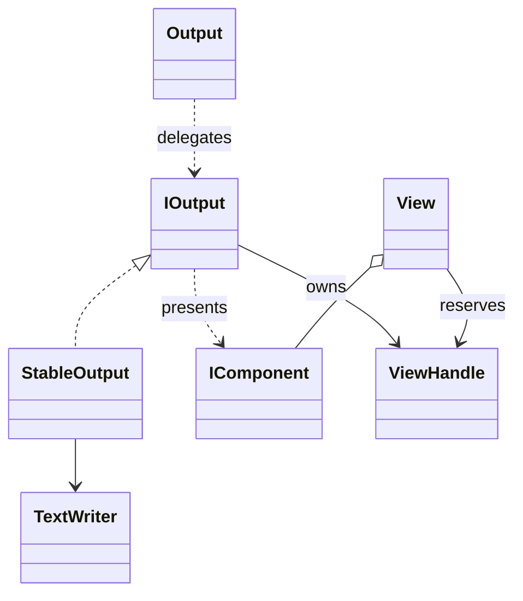

# Output

Output services place descriptions and own live regions. They are separate from constructors and from command execution.

## Responsibilities

Own placement, handle lifetimes and output routing. Constructors provide descriptions; command handlers own actual work; output services provide a human representation or stable event history.

## API contract

These declarations describe the accepted surface, not an implementation. Extension blocks illustrate the recent C# facade shape; the exact SDK baseline is a [[docs/questions/dotnet-version|separate decision]].

```csharp
public interface IOutput
{
    ViewHandle Show(params IComponent[] content);
    ViewHandle Update(ViewHandle view, params IComponent[] content);
    void Close(ViewHandle view);
    void Remove(ViewHandle view);
}

public static class Output
{
    public static ViewHandle Show(params IComponent[] content);
    public static ViewHandle Update(ViewHandle view, params IComponent[] content);
    public static void Close(ViewHandle view);
    public static void Remove(ViewHandle view);

    extension(IComponent component)
    {
        public ViewHandle Show();
    }

    extension(ViewHandle view)
    {
        public ViewHandle Update(params IComponent[] content);
        public void Close();
        public void Remove();
    }
}

public sealed class StableOutput : IOutput
{
    public StableOutput(TextWriter writer);
    public ViewHandle Show(params IComponent[] content);
    public ViewHandle Update(ViewHandle view, params IComponent[] content);
    public void Close(ViewHandle view);
    public void Remove(ViewHandle view);
}
```

## Class diagram



A static class cannot implement IOutput. Stateful implementations own sessions; Output is a convenience facade. Component.Show uses the configured default. Handle operations use their original owner even if a different default is subsequently selected. [[docs/questions/default-output-scope|Default output scope]] defines the remaining session-selection decision.

## Rules

| Action | Effect |
|---|---|
| Show | Places ordered blocks and returns a root grouping handle |
| Update | Replaces content and returns the same handle |
| Close | Freezes visible content and stops animations |
| Remove | Removes the owned editable representation and invalidates descendants |

An empty Show creates a zero-height handle. Empty Update clears an active region without closing it. Repeated known Close/Remove are no-ops. Updating a closed or removed handle fails. Explicit nested Views retain identity only while the same child View remains present. Neither Close nor Remove signals success.

Each Show argument begins a block, not necessarily one physical row. Use Line to join inline pieces. Validate descriptions before emitting; I/O can still fail after output starts. An implementation does not own arbitrary terminal scrollback, prompts or another program's writes.

## Stable output

StableOutput appends meaningful state updates to its supplied TextWriter, without cursor rewriting or frame events. It does not close that writer. There is no constructor that silently chooses stdout and risks mixing human feedback with domain output.

Remove deactivates its logical handle; already written lines remain. Do not add a blank line around every event or flood logs with animation frames. Throttling internals do not change original task data.

## Example

```csharp
IOutput output = new StableOutput(Console.Error);
var handle = output.Show(new ActivityDisplay("Resolving dependencies"));
output.Update(handle, new ActivityDisplay(
    "Resolving dependencies", state: TaskState.Succeeded));
output.Close(handle);
```

Structured values remain separate from human feedback and are never polluted with cursor sequences or decorative spacing. See [[docs/integration/adapter-boundaries|Adapter boundaries]].
