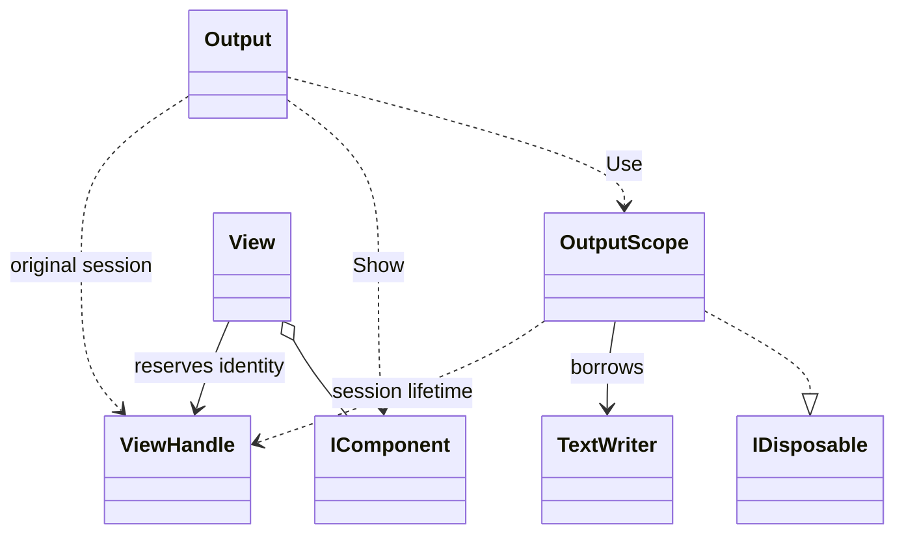

# Sessions and handles

A scope establishes the default human-output destination for its asynchronous execution flow. Handles address the session in which they were mounted, independently of subsequent default selection.

## Responsibilities

The static Output facade and extension methods expose placement actions. OutputScope owns the rendering-session lifetime, not the supplied TextWriter. View reserves an identity for explicit groups; ordinary reusable descriptions have no output identity.

## API contract

These are API extracts, not implementation bodies or a compiling source file. Input unions and extension blocks use the [[docs/integration/build-baseline|C# 15 preview baseline]].

```csharp
public static class Output
{
    public static OutputScope Use(TextWriter writer);

    public static ViewHandle Show(params IEnumerable<ComponentInput> content);
    public static ViewHandle Show(IEnumerable<IComponent> content);
    public static ViewHandle Update(ViewHandle view,
        params IEnumerable<ComponentInput> content);
    public static ViewHandle Update(ViewHandle view,
        IEnumerable<IComponent> content);
    public static void Close(ViewHandle view);
    public static void Remove(ViewHandle view);

    extension(IComponent component)
    {
        public ViewHandle Show();
    }

    extension(ViewHandle view)
    {
        public ViewHandle Update(params IEnumerable<ComponentInput> content);
        public ViewHandle Update(IEnumerable<IComponent> content);
        public void Close();
        public void Remove();
    }
}

public sealed class OutputScope : IDisposable
{
    internal OutputScope();
    public void Dispose();
}
```

View and ViewHandle members belong to [[docs/presentation/components/view|View]]. TextWriter and IDisposable are .NET types. The public surface does not expose Spectre types or require an R3CLI writer interface.

## Class diagram



The internal session is a responsibility, not an additional public class declared by this diagram.

## Rules

### Default context and ownership

Use rejects a null writer and establishes a session without emitting content or starting animations. There is no implicit stdout fallback: Show without an active scope fails with InvalidOperationException before writing. An adapter or command host supplies the outer scope, normally routing human feedback to stderr when stdout carries structured values.

Nested scopes restore the previous default on disposal. Context flows across await through the asynchronous execution context, rather than using a thread-local or process-global mutable default. Dispose scopes in reverse nesting order; disposing out of order is invalid. Repeated disposal of an already disposed scope is a no-op. Child work using the scope must finish before its owner disposes it; inheriting context does not extend the session lifetime.

Disposing the scope stops animations, freezes the last owned representation and releases session resources. It does not flush by closing, dispose, or otherwise take ownership of the supplied writer. Subsequent updates through that session's handles fail. A different active scope cannot retarget or revive an existing handle. Scope is a sealed class because lifetime and disposal have identity.

### Placement and actions

| Action | Effect |
|---|---|
| Show | Places ordered blocks and returns their root grouping handle |
| Update | Replaces content and returns the same handle |
| Close | Freezes visible content and stops animation in that group |
| Remove | Removes the owned editable representation and invalidates descendants |

An empty Show creates a zero-height handle. Empty Update clears an active region without closing it. Repeated known Close/Remove are no-ops. Updating a closed or removed handle fails. Remove may erase a closed representation while it remains owned and editable. Removed child Views are invalidated; explicitly retained identical child Views preserve identity. Neither Close nor Remove means success. [[docs/presentation/components/view|View]] owns the single-placement and nesting invariants.

Strings normalize to Text, never Subtext. Existing component collections use the typed overload. Reject null/default union inputs. Each Show argument begins a block, not necessarily one physical row; use Line for inline composition. Validate descriptions before emitting, while allowing for I/O failures after writing starts.

### Coordination

Serialize writes, state changes and frame refreshes within a session. Default-context isolation does not grant independent cursor ownership to sessions sharing one physical terminal: stdout and stderr can lead to the same surface. Coordinate those sessions before rewriting. Arbitrary direct writes and another application's output are not controlled by R3CLI. No operation may clear unrelated screen content or scrollback. When cursor ownership cannot be maintained, use [[docs/presentation/output/capabilities|stable output]].

## Example

```csharp
using var scope = Output.Use(Console.Error);
var summary = new View(new Field("Files", 12));
var report = Output.Show(new Title("Project report"), summary);

summary.Handle.Update(new Field("Files", 25));
summary.Handle.Close();
report.Close();
```

The child freezes independently; closing the report freezes the remaining group. No action closes Console.Error.

```csharp
using var writer = new StreamWriter("report.txt");
using (Output.Use(writer))
{
    Output.Show(new Field("Files", 12));
}
writer.WriteLine("Export complete.");
```

The file writer remains usable after the scope. Its enclosing using declaration owns its disposal. Existing examples that return handles require the host's enclosing scope to remain alive until handle operations finish.
