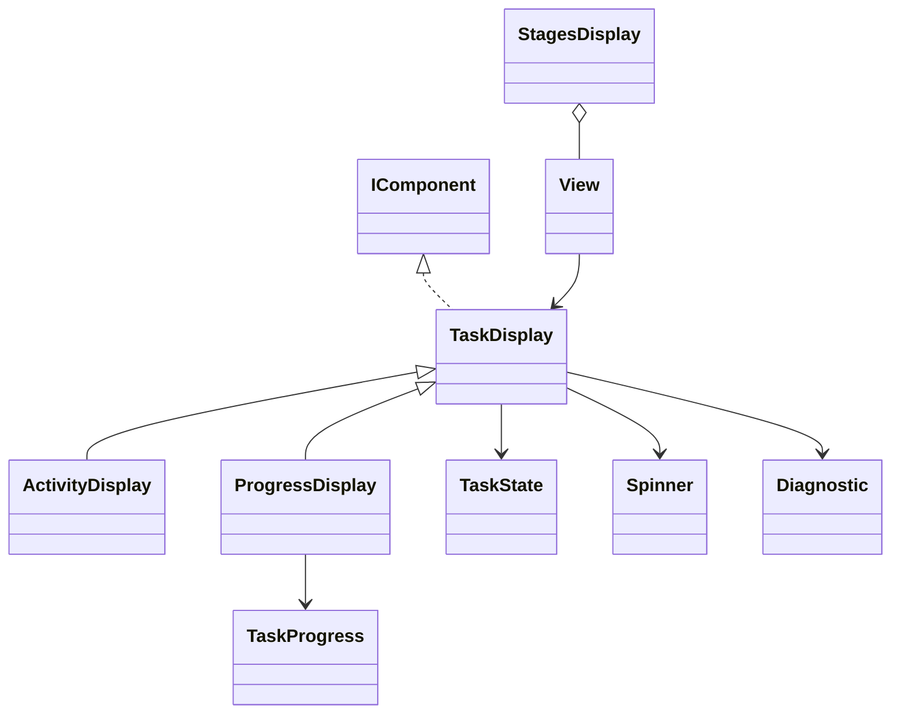

# Progress model

Counts, task state and presentation are separate. Presentation never starts work or infers successful execution.

## Responsibilities

Describe counts and explicit task state for the ready-made activity displays. Output owns animation and lifetime; the application owns execution, cancellation and completion decisions.

## API contract

```csharp
public enum TaskState
{
    Pending, Running, Succeeded, Failed, Cancelled
}

public readonly record struct TaskProgress
{
    public TaskProgress(long completed, long? total = null, string? unit = null);
    public long Completed { get; }
    public long? Total { get; }
    public string? Unit { get; }
}

public abstract class TaskDisplay : IComponent
{
    protected TaskDisplay(string title, string? detail,
        TaskState state, Spinner? spinner, Diagnostic? diagnostic);
    public string Title { get; }
    public string? Detail { get; }
    public TaskState State { get; }
    public Spinner? Spinner { get; }
    public Diagnostic? Diagnostic { get; }
}
```

## Class diagram



## Rules

TaskProgress is an immutable readonly record struct with generated value equality. Its explicit constructor validates Completed, Total and Unit together; get-only properties expose no init path for invalid with-expressions. Counts are nonnegative. Completed cannot exceed a known Total; null means unknown total. Zero/zero represents an empty workload at 100 percent, without implying success. default(TaskProgress) is valid unknown progress. A unit is absent when null; an explicit blank unit is invalid. Replacement counts may decrease and are not silently clamped.

Only Running animates. ActivityDisplay needs no total; ProgressDisplay requires a known one. Reaching the total, assigning a Diagnostic or closing the view does not change State. StagesDisplay does not schedule steps or weight them equally.

## Example

```csharp
var progress = new TaskProgress(25, 40, "files");
var display = new ProgressDisplay("Downloading files", progress);
var handle = display.Show();
handle.Update(new ProgressDisplay("Downloading files",
    new TaskProgress(40, 40, "files"),
    state: TaskState.Succeeded));
handle.Close();
```

Automatic feedback belongs to [[docs/command-system/automatic-activity|Command activity]], not to these data constructors. Stable output is an [[docs/presentation/output/README|output strategy]], not a fourth task state.
